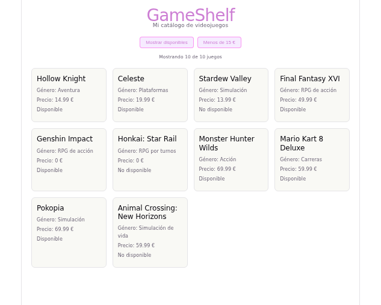
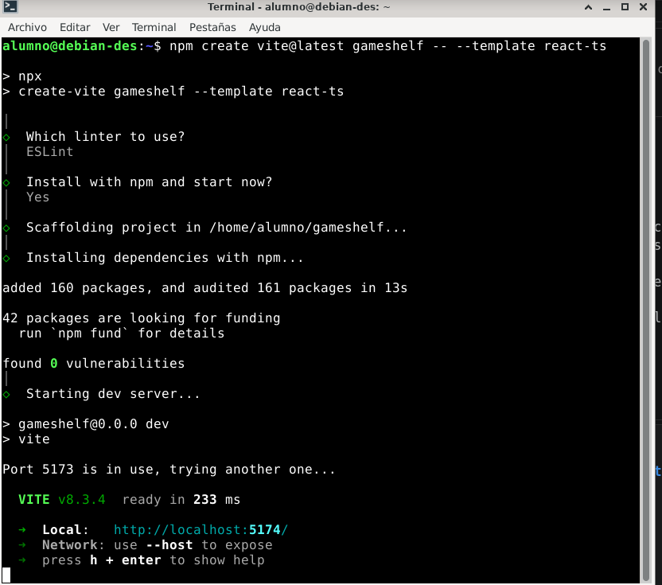
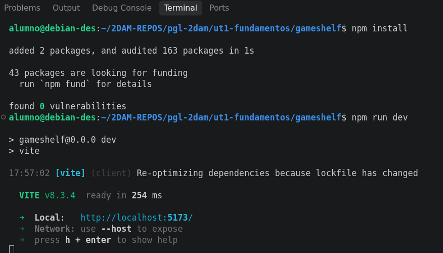
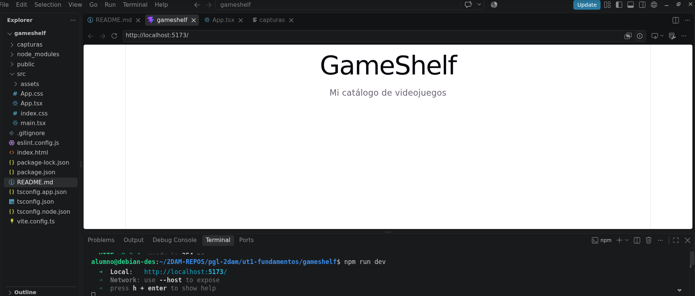
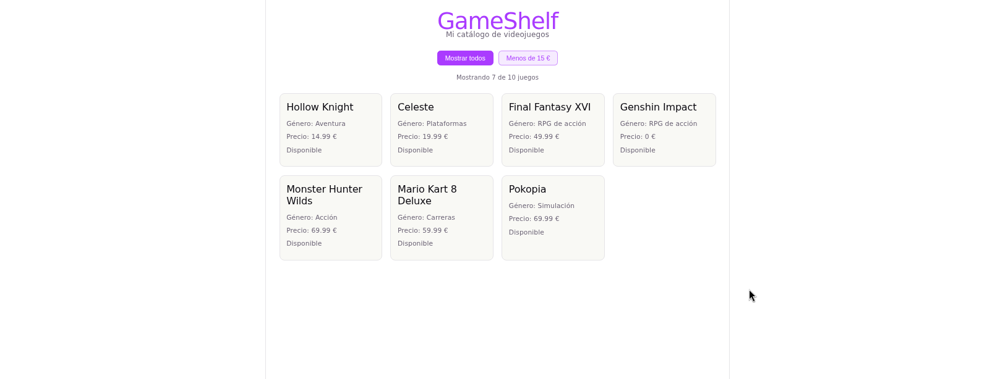
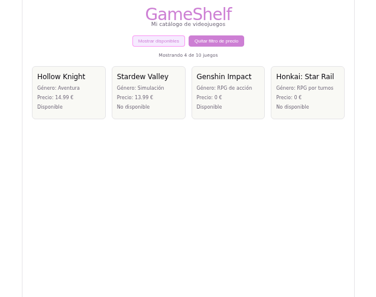

# Mi primera app con React

**Nombre:** Atteneri Bravo Barroso

**Curso:** 2ºDAM

**Proyecto:** GameShelf — catálogo de videojuegos

## Descripción de GameShelf

GameShelf es una pequeña aplicación web hecha con **React + TypeScript** y creada con **Vite**. Muestra un catálogo de 10 videojuegos en forma de tarjetas (título, género, precio y disponibilidad). Tiene dos botones de filtro que se pueden usar por separado o a la vez:

- **Mostrar disponibles**: enseña solo los juegos con `available: true`.
- **Menos de 15 €**: enseña solo los juegos con `price < 15`.

Además, un texto indica cuántos juegos se están mostrando de los 10 totales.



## Herramientas utilizadas

- **Visual Studio Code**: editor de código y terminal integrada.
- **Node.js y npm**: para ejecutar las herramientas de desarrollo e instalar paquetes.
- **Vite** (creado con `create-vite`, plantilla `react-ts`): servidor de desarrollo y compilación.
- **React 19**: biblioteca para construir la interfaz con componentes.
- **TypeScript**: JavaScript con comprobación de tipos.
- **CSS** normal (`src/App.css`) para los estilos.
- **Git y GitHub**: control de versiones y entrega.

## Cómo ejecutar el proyecto

Hace falta tener Node.js y npm instalados (se comprueba con `node --version` y `npm --version`). Después, desde la carpeta del proyecto:

```
npm install
npm run dev
```

Se abre la dirección que aparece en la terminal (normalmente `http://localhost:5173/`).

---

## Preparación e interfaz

### ¿Qué es cada herramienta?

- **¿Qué es React? ¿Es un lenguaje, una biblioteca o una herramienta para crear proyectos?**

  React es una **biblioteca de JavaScript** para construir interfaces de usuario. No es un lenguaje (el lenguaje es JavaScript/TypeScript) ni una herramienta para crear proyectos (eso lo hace Vite). Con React dividimos la pantalla en **componentes** reutilizables, y React se encarga de actualizar la pantalla cuando cambian los datos.
  Fuente: [Aprender React](https://react.dev/learn)

- **¿Qué diferencia hay entre create-vite y Vite? ¿Qué hace Vite mientras ejecutamos npm run dev? ¿Qué crees que hará npm run build?**

  `create-vite` es la herramienta que **genera el proyecto inicial** (carpetas, archivos y configuración) a partir de una plantilla. Se usa una vez, con `npm create vite@latest`. **Vite** es la herramienta que usamos mientras desarrollamos: con `npm run dev` arranca un servidor local, sirve los archivos del proyecto al navegador y, cuando guardamos un cambio, actualiza la página automáticamente. `npm run build` prepara la aplicación para publicarla: en este proyecto primero comprueba los tipos con TypeScript (`tsc -b`) y luego Vite junta y optimiza el código en la carpeta `dist`.
  Fuente: [Guía de inicio de Vite](https://vite.dev/guide/)

- **¿Qué son Node.js y npm? ¿Para qué usamos npm create, npm install y npm run dev?**

  **Node.js** permite ejecutar JavaScript fuera del navegador, y gracias a eso funcionan las herramientas de desarrollo como Vite. **npm** es el gestor de paquetes de Node: descarga e instala los paquetes que necesita el proyecto y ejecuta sus scripts.
  - `npm create vite@latest` ejecuta `create-vite` para crear el proyecto.
  - `npm install` lee `package.json` y descarga las dependencias en `node_modules`.
  - `npm run dev` ejecuta el script `dev` de `package.json` (que lanza Vite).
  Fuentes: [Node.js](https://nodejs.org/es/about) · [Qué es npm](https://docs.npmjs.com/about-npm)

- **¿Qué son las dependencias? ¿Por qué aparece node_modules?**

  Las dependencias son **paquetes de código hechos por otras personas** que nuestra aplicación necesita para funcionar (por ejemplo `react` y `react-dom`) o para desarrollar (`vite`, `typescript`, `eslint`...). Se listan en `package.json` y `npm install` las descarga dentro de la carpeta `node_modules`. Esa carpeta es muy grande y se puede volver a generar con `npm install`, por eso está en `.gitignore` y no se sube a GitHub.
  Fuente: [Qué es npm](https://docs.npmjs.com/about-npm)

- **¿Qué añade TypeScript a JavaScript?**

  TypeScript añade **tipos** a JavaScript: podemos decir que una variable es `string`, `number` o `boolean`, o describir la forma de un objeto (como `Game`). El editor y el compilador avisan de errores antes de ejecutar (por ejemplo, si a un juego le falta el precio o si el precio es un texto). Al final el navegador ejecuta JavaScript normal: los tipos desaparecen al compilar.
  Fuente: [TypeScript para programadores de JavaScript](https://www.typescriptlang.org/docs/handbook/typescript-in-5-minutes.html)

- **¿Qué significan JSX y TSX?**

  **JSX** es una sintaxis parecida a HTML que se escribe dentro de JavaScript para describir lo que se ve en pantalla (`<h1>GameShelf</h1>`). **TSX** es lo mismo pero en un archivo de TypeScript: la extensión `.tsx` indica que el archivo tiene TypeScript y JSX. Un navegador no entiende JSX directamente; Vite lo transforma a JavaScript.
  Fuente: [Escribir marcado con JSX](https://react.dev/learn/writing-markup-with-jsx)

## ¿Qué es cada archivo?


| Archivo/carpeta | Pregunta para investigar | Función |
|---|---|---|
| `index.html` | ¿Qué elemento tiene `id="root"`? | Tiene un `<div id="root">`. Es la **única página HTML** y el punto de entrada: ahí es donde React dibuja la aplicación. También carga `src/main.tsx` con una etiqueta `<script type="module">`. |
| `src/main.tsx` | ¿Qué componente importa? ¿Dónde aparece `createRoot`? | Importa el componente `App` (y `index.css`). Usa `createRoot(document.getElementById('root'))` para decirle a React que dibuje `<App />` dentro del `div` con id `root`. |
| `src/App.tsx` | ¿Qué interfaz se muestra? | Es el **componente principal**. Contiene el título, los botones de filtro y el catálogo con las tarjetas, además de los datos y el estado. |
| `src/App.css` | ¿Qué reglas visuales aparecen? | Contiene mis estilos: `.app`, `.filters`, `.filter-button`, `.catalog` y `.card`, entre otros. |
| `src/index.css` | ¿En qué se diferencia de `App.css`? | `index.css` tiene estilos **globales** (variables de color, tipografía, `body`, `h1`, `h2`, `#root`) y se carga desde `main.tsx` para toda la página. `App.css` tiene estilos del componente `App` y se carga desde `App.tsx`. |
| `package.json` | ¿Qué comandos aparecen en `scripts`? | `dev` (`vite`), `build` (`tsc -b && vite build`), `lint` (`eslint .`) y `preview` (`vite preview`). También lista las dependencias del proyecto. |
| `tsconfig.json` | ¿Qué indica “ts”? ¿Necesitas editarlo hoy? | “ts” es TypeScript, es la configuración del compilador. Aquí solo apunta a `tsconfig.app.json` (código de la app) y `tsconfig.node.json` (configuración de Vite). No hace falta editarlo. |
| `vite.config.ts` | ¿Qué nombre de herramienta aparece? | Aparece **Vite** (`defineConfig`) y el plugin de React (`@vitejs/plugin-react`), que permite que Vite entienda JSX/TSX. |
| `public/` y `src/assets/` | ¿Qué recursos encuentras? | `public/` guarda archivos que se sirven tal cual (`favicon.svg`, `icons.svg`). `src/assets/` guarda imágenes que se importan desde el código (`react.svg`, `vite.svg`, `hero.png`). |
| `node_modules/` | ¿Qué contiene? ¿Por qué no se sube? | Contiene el código de todas las dependencias instaladas. No se sube porque pesa mucho y se regenera con `npm install` a partir de `package.json`. |
| `.gitignore` | ¿Qué archivos o carpetas ignora Git? | Ignora `node_modules`, `dist`, archivos de logs (`*.log`), archivos locales (`*.local`) y archivos del editor (`.idea`, `.DS_Store`, `.vscode/*`...). |

**Preguntas rápidas:**

- **¿Qué archivo contiene el punto de entrada HTML?** `index.html`.
- **¿Qué archivo carga `App`?** `src/main.tsx`, que lo importa y lo dibuja con `createRoot(...).render(<App />)`.
- **¿Cuál es el componente principal?** `App` (en `src/App.tsx`).
- **¿Qué hace el script `dev`?** Ejecuta `vite`, que arranca el servidor local de desarrollo con recarga automática.
- **¿Qué significa la extensión `.tsx`?** Archivo de TypeScript que además contiene JSX.


## Glosario

| Concepto | Definición | Fuente |
|---|---|---|
| JavaScript | Lenguaje de programación de la web. Es el que ejecuta el navegador. | [MDN](https://developer.mozilla.org/es/docs/Learn_web_development/Core/Scripting/What_is_JavaScript) |
| TypeScript | JavaScript con tipos. Detecta errores antes de ejecutar el programa. | [TypeScript](https://www.typescriptlang.org/docs/handbook/typescript-in-5-minutes.html) |
| JSX | Sintaxis parecida a HTML que se escribe dentro del código JavaScript para describir la interfaz. | [React](https://react.dev/learn/writing-markup-with-jsx) |
| TSX | Archivo de TypeScript que además contiene JSX (`App.tsx`, `GameCard.tsx`). | [React](https://react.dev/learn/typescript) |
| Componente | Parte reutilizable de la interfaz: una función que devuelve JSX. Ejemplo: `GameCard`. | [React](https://react.dev/learn/your-first-component) |
| Props | Datos que un componente recibe de quien lo usa, como los argumentos de una función. `GameCard` recibe `title`, `genre`, `price` y `available`. | [React](https://react.dev/learn/passing-props-to-a-component) |
| Función | Bloque de instrucciones con nombre que se puede ejecutar cuando se necesita. | [MDN](https://developer.mozilla.org/es/docs/Web/JavaScript/Guide/Functions) |
| Parámetro | Nombre que recibe un valor dentro de una función. En `(game) => game.available`, `game` es el parámetro. | [MDN](https://developer.mozilla.org/es/docs/Web/JavaScript/Guide/Functions) |
| Función flecha | Forma corta de escribir una función: `(parámetros) => resultado`. | [MDN](https://developer.mozilla.org/es/docs/Web/JavaScript/Reference/Functions/Arrow_functions) |
| Evento | Algo que ocurre en la página, como un clic en un botón. | [React](https://react.dev/learn/responding-to-events) |
| Manejador | Función que se ejecuta cuando ocurre un evento. En mi app, el manejador del clic cambia el estado del filtro. | [React](https://react.dev/learn/responding-to-events) |
| Estado | Dato que React recuerda entre renderizados y que, al cambiar, hace que la pantalla se actualice. | [React](https://react.dev/learn/state-a-components-memory) |
| Callback | Función que se entrega a otra función para que esta la ejecute más tarde. `map()` y `filter()` reciben callbacks, y `onClick` también. | [MDN](https://developer.mozilla.org/es/docs/Glossary/Callback_function) |

---

## Ejecución del proyecto 

Después de comprobar que tengo node y npm:

```
node --version
npm --version
```

creo el proyecto con Vite.

Me sitúo en la carpeta donde guardo el trabajo y ejecuto `npm create vite@latest gameshelf -- --template react-ts`.




- `npm create` ejecuta una herramienta de creación de proyectos.
- `vite@latest` indica que se utilizará la versión más reciente de Vite.
- `gameshelf` será el nombre de la carpeta del proyecto.
- `--template react-ts` pide la plantilla de React con TypeScript.

Luego entro en la carpeta e instalo las dependencias:

```
cd gameshelf
npm install
```

Ahora ejecuto la aplicación inicial con `npm run dev`, y abro en el navegador la dirección que aparece, normalmente `http://localhost:5173/`. Mantengo la terminal abierta ya que Vite sirve el proyecto y actualiza el navegador cuando guardo cambios.

`npm create` ejecuta `create-vite`, que genera la estructura inicial usando la plantilla elegida. Vite es la herramienta que ofrece el servidor local de desarrollo y prepara la compilación para publicar. React es la biblioteca con la que escribiremos los componentes y el comportamiento de la interfaz.





## Componentes, catálogo y estilos

### Pantalla inicial

Abrimos `src/App.tsx`, borramos el ejemplo de Vite y lo sustituimos por:

```tsx
import "./App.css";

function App() {
  return (
    <main className="app">
      <h1>GameShelf</h1>
      <p>Mi catálogo de videojuegos</p>
    </main>
  );
}

export default App;
```

Guardamos con `Ctrl + S` y aparece el nuevo título en el navegador.



- `function App()` declara el componente App.
- `return` indica qué interfaz devuelve.
- Las etiquetas `main`, `h1` y `p` se parecen a HTML y están escritas en JSX.
- En JSX usamos `className` para enlazar una clase CSS; en HTML se usa habitualmente `class` (en JSX no se puede porque `class` es una palabra reservada de JavaScript).
- El `import` carga `App.css`.
- El `export` permite que `main.tsx` pueda utilizar `App`.

**¿Qué es un componente?** Un componente es una parte reutilizable de la interfaz. En React es una función que devuelve elementos visuales (JSX). Se usa escribiendo su nombre como si fuera una etiqueta (`<App />`, `<GameCard />`). **Ahora la página muestra** el título “GameShelf” y el texto “Mi catálogo de videojuegos”, que los devuelve el componente `App`.

## Tarjeta del videojuego

Dentro de `src` creamos la carpeta `components`, y dentro `GameCard.tsx`:

```tsx
type GameCardProps = {
  title: string;
  genre: string;
  price: number;
  available: boolean;
};

export default function GameCard({
  title,
  genre,
  price,
  available,
}: GameCardProps) {
  return (
    <article className="card">
      <h2>{title}</h2>
      <p>Género: {genre}</p>
      <p>Precio: {price} €</p>
      <p>{available ? "Disponible" : "No disponible"}</p>
    </article>
  );
}
```

`GameCard` recibe **props**: `title`, `genre`, `price` y `available`. `GameCardProps` describe sus nombres y tipos. JavaScript también puede pasar props, pero TypeScript permite comprobar si el componente recibe el tipo de valor esperado.

Dentro de JSX, las llaves `{ }` permiten insertar expresiones JavaScript. `available ? "Disponible" : "No disponible"` es un **ternario**: si `available` es verdadero aparece “Disponible”; si es falso, aparece “No disponible”.

**¿Qué son las props de GameCard?** Son los cuatro datos que `App` le pasa a cada tarjeta (`title`, `genre`, `price`, `available`). La tarjeta no tiene los datos guardados dentro: solo los recibe y los muestra, por eso se puede reutilizar para cualquier juego.

## Datos y tres tarjetas

Reemplazamos `src/App.tsx` por una versión con un array de datos y `map()`:

```tsx
const games: Game[] = [
  { id: 1, title: "Hollow Knight", genre: "Aventura", price: 14.99, available: true },
  { id: 2, title: "Celeste", genre: "Plataformas", price: 19.99, available: true },
  { id: 3, title: "Stardew Valley", genre: "Simulación", price: 13.99, available: false },
];

// ...dentro del componente:
<section className="catalog">
  {games.map((game) => (
    <GameCard
      key={game.id}
      title={game.title}
      genre={game.genre}
      price={game.price}
      available={game.available}
    />
  ))}
</section>
```


- `type Game` describe la estructura de cada videojuego.
- `string` significa texto; `number`, número; `boolean`, `true` o `false`.
- `Game[]` significa array de elementos `Game`.
- TypeScript comprueba que los objetos tengan esas propiedades y tipos. JavaScript podría ejecutar el array sin declarar el tipo `Game`.

### Funciones, parámetros, `map()` y `key`

- **¿Qué es una función?** Un bloque de instrucciones con nombre que podemos ejecutar cuando queramos y reutilizar. Puede recibir datos (parámetros) y devolver un resultado.
- **¿Qué diferencia hay entre definirla y llamarla?** *Definir* una función es escribirla (`function saludar() { alert("Hola"); }`): solo la deja preparada, no hace nada todavía. *Llamarla* es pedir que se ejecute, escribiendo su nombre con paréntesis: `saludar()`.
- **¿Qué recibe el parámetro `game` en cada vuelta?** Un videojuego distinto del array: en la primera vuelta Hollow Knight, en la segunda Celeste, y así hasta el último.
- **¿Qué devuelve la función flecha dentro de `map()`?** Un componente `<GameCard ... />` con los datos de ese juego. `map()` junta todos esos componentes en una lista nueva que React dibuja.
- **¿Qué hace `map()`?** Es un método de los arrays que recorre cada elemento y lo **transforma**, creando un array nuevo. Aquí transforma cada objeto `Game` en una tarjeta. Sin `map()` tendríamos que escribir una tarjeta a mano por cada juego.
- **¿Por qué se usa `key`?** React necesita una identificación **estable y única** de cada elemento de una lista para reconocer cuál es cuál cuando la lista cambia (por ejemplo, cuando un filtro quita tarjetas) y actualizar solo lo necesario. Usamos `key={game.id}` porque cada juego tiene un `id` único. `key` solo la usa React: no llega a `GameCard` como prop.

Fuentes: [Mostrar listas](https://react.dev/learn/rendering-lists) · [Array.prototype.map() en MDN](https://developer.mozilla.org/es/docs/Web/JavaScript/Reference/Global_Objects/Array/map) · [Funciones en MDN](https://developer.mozilla.org/es/docs/Web/JavaScript/Guide/Functions)

## Ampliación del catálogo

Conservé los tres juegos de ejemplo (Hollow Knight, Celeste y Stardew Valley) y añadí **7 juegos más**, hasta llegar a **10 tarjetas**. Elegí juegos que me gustan o que conozco, de géneros distintos (RPG, simulación, carreras, acción, roguelike, plataformas...). Para que los filtros se pudieran probar bien, mezclé precios por encima y por debajo de 15 € y puse algunos como no disponibles.

Cada objeto tiene un `id` numérico **único** (del 1 al 10), un título, un género, un precio **numérico sin comillas** y `available` como `true` o `false`. TypeScript avisaría con un error si faltara alguna propiedad o si tuviera un tipo incorrecto.

| id | Título | Género | Precio | Disponible |
|---|---|---|---|---|
| 1 | Hollow Knight | Aventura | 14.99 | Sí |
| 2 | Celeste | Plataformas | 19.99 | Sí |
| 3 | Stardew Valley | Simulación | 13.99 | No |
| 4 | Final Fantasy XVI | RPG de acción | 49.99 | Sí |
| 5 | Genshin Impact | RPG de acción | 0.00 | Sí |
| 6 | Honkai: Star Rail | RPG por turnos | 0.00 | No |
| 7 | Monster Hunter Wilds | Acción | 69.99 | Sí |
| 8 | Mario Kart 8 Deluxe | Carreras | 59.99 | Sí |
| 9 | Pokopia | Simulación | 69.99 | Sí |
| 10 | Animal Crossing: New Horizons | Simulación de vida | 59.99 | No |

<br>


## Estilos CSS

**¿Qué es CSS?** Es el lenguaje que define cómo se ve una página: colores, tamaños, márgenes, distribución... Sin CSS las tarjetas aparecen apiladas y sin formato (como en la captura de las tres tarjetas).

**¿Qué es un selector?** Es la parte de la regla que dice **a qué elementos** se aplica. Un selector de clase empieza por un punto: `.card` se aplica a todos los elementos que tengan la clase `card`.

**¿Qué es una propiedad CSS?** Es cada ajuste concreto dentro de una regla, con su valor: `border-radius: 12px;` (propiedad `border-radius`, valor `12px`).

**¿Dónde escribí los estilos?** En `src/App.css`, que es CSS normal. `App.tsx` lo carga con `import "./App.css";`, por eso las reglas afectan a la interfaz. También reutilicé las variables de color que ya estaban definidas en `src/index.css` (`var(--accent)`, `var(--border)`, etc.).

**¿Cómo conecté el TSX con el CSS?** Poniendo una clase en el elemento con `className` y escribiendo en el CSS un selector de clase con el mismo nombre. En JSX se escribe `className` (porque `class` es una palabra reservada de JavaScript), y en el archivo CSS se escribe el selector con punto:

```tsx
<article className="card">   {/* en GameCard.tsx */}
```
```css
.card { border-radius: 12px; }   /* en App.css */
```

Reglas que creé:

| Selector (clase) | Dónde se usa en el TSX | Qué hace |
|---|---|---|
| `.app` | `<main className="app">` | Añade espacio interior (`padding`) a toda la página. |
| `.app h1` | el título | Cambia el color del título al color de acento (`color`) y ajusta márgenes. |
| `.subtitle` | `<p className="subtitle">` | Da color y separación al texto bajo el título. |
| `.filters` | `<div className="filters">` | Usa `display: flex` para colocar los botones en fila, centrados y con espacio (`gap`). |
| `.filter-button` | los dos botones | Fondo suave, borde redondeado (`border-radius`), tamaño de letra y cursor de mano. |
| `.filter-button:hover` | los botones al pasar el ratón | Resalta el borde. |
| `.filter-button.active` | el botón con el filtro activado | Lo pinta con color sólido para que se vea que está activo. |
| `.counter-text` | el texto “Mostrando X de 10 juegos” | Tamaño y margen. |
| `.catalog` | `<section className="catalog">` | `display: grid` con `repeat(auto-fill, minmax(240px, 1fr))`: reparte las tarjetas en columnas y se adapta al ancho de la pantalla. |
| `.card` | `<article className="card">` | Padding, borde, esquinas redondeadas y fondo; efecto de elevación al pasar el ratón (`transform` + `box-shadow`). |
| `.card h2`, `.card p` | título y textos de cada tarjeta | Márgenes y tamaño de letra dentro de la tarjeta. |

El botón activo cambia de aspecto porque su `className` se calcula con un ternario: `className={onlyAvailable ? "filter-button active" : "filter-button"}`.

Fuentes: [Selectores de clase (MDN)](https://developer.mozilla.org/es/docs/Web/CSS/Class_selectors) · [CSS Grid (MDN)](https://developer.mozilla.org/es/docs/Web/CSS/CSS_grid_layout) · [Flexbox (MDN)](https://developer.mozilla.org/es/docs/Web/CSS/CSS_flexible_box_layout)

---

## Interactividad, documentación y publicación

### Filtro de disponibilidad

**Estado vs variable normal.** Una variable normal puede cambiar, pero React no se entera y **no vuelve a dibujar la pantalla**; además, su valor se pierde en cada renderizado. El **estado** (`useState`) es un dato que React recuerda entre renderizados y, cuando se actualiza con su función, React **vuelve a renderizar el componente** y la interfaz refleja el nuevo valor.

**Definir/llamar y `onClick`.** Para que el botón funcione hay que *entregar* una función a `onClick` para que React la ejecute **más tarde, al hacer clic**. Si escribiéramos `onClick={saludar()}`, la función se llamaría en el momento de dibujar la pantalla y no al pulsar. En cambio, `onClick={saludar}` y `onClick={() => saludar()}` esperan al clic. `onClick` es la prop de JSX que escucha el evento de clic (con C mayúscula).

Código del estado y del cálculo en `App.tsx`:

```tsx
import { useState } from "react";

const [onlyAvailable, setOnlyAvailable] = useState(false);

const availableFiltered = onlyAvailable
  ? games.filter((game) => game.available)
  : games;
```

- `useState` es un **hook** de React. `false` es el valor inicial.
- `onlyAvailable` es el valor actual y `setOnlyAvailable` es la función para cambiarlo. Los corchetes son **desestructuración** de JavaScript. TypeScript deduce que es booleano porque empieza en `false`.
- `filter()` es un método de los arrays que crea una **lista nueva** con los elementos que cumplen una condición. `(game) => game.available` es una función flecha: `filter` la llama con cada juego y conserva los que devuelven `true`.
- El ternario significa: si `onlyAvailable` es verdadero, usa la lista filtrada; si no, usa `games` completo.

El botón:

```tsx
<button onClick={() => setOnlyAvailable(!onlyAvailable)}>
  {onlyAvailable ? "Mostrar todos" : "Mostrar disponibles"}
</button>
```

**Qué hace cada parte de `() => setOnlyAvailable(!onlyAvailable)`:**

- `()` : los paréntesis vacíos indican que la función flecha **no tiene parámetros**.
- `=>` : la flecha separa los parámetros del código que se ejecutará.
- `setOnlyAvailable(...)`: es la función actualizadora del estado. Se ejecuta **solo cuando se hace clic**, no al dibujar la pantalla.
- `!onlyAvailable`: el signo `!` **invierte** el valor: `false` pasa a `true` y `true` pasa a `false`.

Al hacer clic, React cambia el estado y vuelve a renderizar `App`: se recalcula la lista y cambia el texto del botón (otro ternario).

**¿Por qué usamos `setOnlyAvailable` para cambiar el estado?** Porque React solo sabe que el estado ha cambiado si lo cambiamos con la función que nos da `useState`. Si hiciéramos `onlyAvailable = true` directamente, el valor cambiaría pero la pantalla no se actualizaría.



## Mini reto: juegos por menos de 15 €

Añadí un **segundo estado booleano**, `onlyUnder15`, que empieza en `false`, y un segundo botón. La clave para que los filtros se **combinen** es que el filtro de precio se aplica sobre la lista que ya salió del filtro de disponibilidad (no sobre `games`):

```tsx
const [onlyAvailable, setOnlyAvailable] = useState(false);
const [onlyUnder15, setOnlyUnder15] = useState(false);

// 1.º disponibilidad
const availableFiltered = onlyAvailable
  ? games.filter((game) => game.available)
  : games;

// 2.º precio, sobre la lista anterior
const visibleGames = onlyUnder15
  ? availableFiltered.filter((game) => game.price < 15)
  : availableFiltered;
```

```tsx
<button onClick={() => setOnlyUnder15(!onlyUnder15)}>
  {onlyUnder15 ? "Quitar filtro de precio" : "Menos de 15 €"}
</button>
```

Y el `map()` usa la lista resultante de ambos filtros: `visibleGames.map(...)`.

- **¿Qué significa `game.price < 15`?** Que el precio del juego es estrictamente menor que 15. Un juego de 15.00 no entraría; uno de 14.99 sí.
- **¿Qué lista debe pasar por el segundo `filter()`?** La que sale del primer filtro (`availableFiltered`). Si volviera a empezar por `games`, el filtro de precio ignoraría el de disponibilidad y no se combinarían.
- **¿Cómo invierto el estado?** Con `setOnlyUnder15(!onlyUnder15)`.
- **¿Qué texto ve la persona?** Con el filtro apagado, “Menos de 15 €”; con el filtro activo, “Quitar filtro de precio”.
- **`useState` devuelve** un par: el **valor actual** y una **función actualizadora**. Cada vez que se llama a esa función, React **vuelve a renderizar** el componente con el nuevo valor.
- `filter()` **no modifica** el array original `games`: crea listas nuevas para dibujar.

Como extra añadí un contador con la propiedad `length` de la lista visible: `Mostrando {visibleGames.length} de {games.length} juegos`.



## Cómo probé los filtros

Comprobé los resultados a mano en el navegador y también con una prueba automática que pulsaba los botones y contaba las tarjetas. Con mis 10 juegos, los resultados esperados (calculados a partir de los datos de la tabla) son:

| Filtros activados | Resultado | Nº de tarjetas |
|---|---|---|
| Ninguno | Los 10 juegos | 10 |
| Solo disponibles | Los juegos con `available: true`: Hollow Knight, Celeste, Final Fantasy XVI, Genshin Impact, Monster Hunter Wilds, Mario Kart 8 Deluxe, Pokopia | 7 |
| Solo menos de 15 € | Hollow Knight, Stardew Valley, Genshin Impact, Honkai: Star Rail | 4 |
| Disponibles y menos de 15 € | Hollow Knight, Genshin Impact | 2 |

Además comprobé que al desactivar el filtro de precio se vuelve a la lista del filtro de disponibilidad, y que al desactivar los dos vuelven los 10 juegos.

## Dificultades que aparecieron y cómo las resolví

- **El botón de disponibles no cambiaba nada.** Al añadir el botón, el `map()` seguía recorriendo `games` en lugar de `visibleGames`, así que el estado cambiaba (el texto del botón se actualizaba) pero la lista seguía igual. Lo resolví cambiando `games.map(...)` por `visibleGames.map(...)`.
- **Combinar los dos filtros.** El problema es que el segundo filtro podía empezar otra vez desde `games` y anular el primero. Lo resolví aplicando el filtro de precio sobre `availableFiltered`, la lista que ya salió del primer filtro.
- **Estilos sobrantes de Vite.** `App.css` y `index.css` traían estilos de la demo (`.counter`, `.hero`, `#next-steps`...) que no uso en GameShelf. Sustituí el contenido de `App.css` por mis propias reglas y dejé en `index.css` solo los estilos globales y variables que aprovecho.
- **Distinguir pasar una función de llamarla.** Me costó entender por qué `onClick={saludar()}` es un error y `onClick={() => saludar()}` no: en el primero se llama durante el renderizado; en el segundo se entrega una función que se ejecutará en el clic.

## Reflexión final

- **¿Qué archivo conecta el HTML con `App`?** `src/main.tsx`: el `index.html` carga ese archivo con un `<script type="module">`, y `main.tsx` importa `App` y lo dibuja dentro del `div#root` con `createRoot`.
- **¿Qué diferencias hay entre React, TypeScript y Vite?** React es la biblioteca con la que construimos la interfaz con componentes. TypeScript es el lenguaje (JavaScript + tipos) en el que escribimos el código y que detecta errores. Vite es la herramienta de desarrollo que sirve el proyecto, convierte TSX en JavaScript y lo compila para publicar.
- **¿Qué son las props de `GameCard`?** Los datos (`title`, `genre`, `price`, `available`) que recibe desde `App` para pintar cada tarjeta.
- **¿Por qué usamos `setOnlyAvailable` para cambiar el estado?** Porque React solo detecta el cambio y vuelve a renderizar si usamos la función actualizadora de `useState`.
- **¿Qué hacen `map()` y `filter()`?** `map()` transforma cada elemento de un array y devuelve un array nuevo (de juegos a tarjetas). `filter()` devuelve un array nuevo solo con los elementos que cumplen una condición (los disponibles, los de menos de 15 €). Ninguno modifica el array original.
- **¿Para qué sirve `key`?** Para que React identifique cada elemento de una lista y actualice solo lo necesario cuando la lista cambia.
- **¿Qué error me costó más resolver y cómo lo solucioné?** Que el filtro no tuviera efecto porque el `map()` seguía usando `games` en vez de `visibleGames`.

---

## Enlace al repositorio de GitHub
[https://github.com/Atthemyg/pgl-2dam/tree/main/ut1-fundamentos/gameshelf](https://github.com/Atthemyg/pgl-2dam/tree/main/ut1-fundamentos/Gameshelf)
