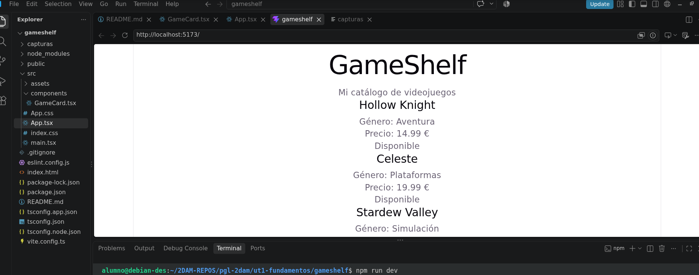

# Mi primera app con React

**Nombre:**Atteneri Bravo Barroso
**Curso:**2ºDAM

Gameshelf es ...

## ¿Qué es cada herramienta?

- **¿Qué es React? ¿Es un lenguaje, una biblioteca o una herramienta para crear proyectos?**

- **¿Qué diferencia hay entre create-vite y Vite? ¿Qué hace Vite mientras ejecutamos npm run dev? ¿Qué crees que hará npm run build?**

- **¿Qué son Node.js y npm? ¿Para qué usamos npm create, npm install y npm run dev?**

- **¿Qué son las dependencias? ¿Por qué aparece node_modules?**

- **¿Qué añade TypeScript a JavaScript?**

- **¿Qué significan JSX y TSX?**

## ¿Qué es cada archivo?

[tabla]

## Herramientas utilizadas

...

## Ejecución del proyecto 

Después de comprobar que tenemos node y npm:

```
node --version
npm --version
```

crearemos el proyecto con Vite.

Nos situaremos en la carpeta donde guardaremos nuestro trabajo y ejecutaremos `npm create vite@latest gameshelf -- --template react-ts`.


- `npm create` ejecuta una herramienta de creación de proyectos.
- `vite@latest` indica que se utilizará la versión más reciente de Vite.
- `gameshelf` será el nombre de la carpeta del proyecto.
- `--template react-ts` pide la plantilla de React con TypeScript.

Luego entraremos en la carpeta e instalaremos las dependencias:

```
cd gameshelf
npm install
```

Ahora ejecutaremos la aplicación inicial con `npm run dev`, y abriremos en el navegador la dirección que aparece, normalmente `http://localhost:5173/`. Mantendremos la terminal abierta ya que Vite sirve el proyecto y actualiza el navegador cuando guardasmos cambios.

`npm create` ejecuta `create-vite`, que genera la estructura inicial usando la plantilla elegida. Vite es la herramienta que ofrece el servidor local de desarrollo y prepara la compilación para publicar. React es la biblioteca con la que escribiremos los componentes y el comportamiento de la interfaz.


## Pantalla inicial

Abriremos `src/App.tsx`, borramos el ejemplo de Vite y lo sustituimos por:

```
import "./App.css";

function App() {
  return (
    <main className="app">
      <h1>GameShelf</h1>
      <p>Mi catálogo de videojuegos</p>
    </main>
  );
}

export default App;
```

Guardamos con `Ctrl+S` y aparecerá el nuevo titulo en el navegador


- `function App()` declara el componente App.
- `return` indica qué interfaz devuelve.
- Las etiquetas `main`, `h1` y `p` se parecen a HTML y están escritas en JSX.
- En JSX usamos `className` para enlazar una clase CSS; en HTML se usa habitualmente `class`.
- El `import` carga `App.css`.
- El `export` permite que `main.tsx` pueda utilizar App.

QUE SIGNIFICA COMPONENTE AQUI

## Tarjeta del videojuego

Dentro de `src`, crearemos la carpeta `components`. Dentro de ella creamos `GameCard.tsx` y escribimos:

```
type GameCardProps = {
  title: string;
  genre: string;
  price: number;
  available: boolean;
};

export default function GameCard({
  title,
  genre,
  price,
  available,
}: GameCardProps) {
  return (
    <article className="card">
      <h2>{title}</h2>
      <p>Género: {genre}</p>
      <p>Precio: {price} €</p>
      <p>{available ? "Disponible" : "No disponible"}</p>
    </article>
  );
}
```

`GameCard` recibe props: `title`, `genre`, `price` y `available`. 

`GameCardProps` describe sus nombres y tipos. JavaScript también puede pasar props, pero TypeScript permite comprobar si el componente recibe el tipo de valor esperado.

Dentro de JSX, las llaves permiten insertar expresiones JavaScript. `available ? "Disponible" : "No disponible"` es un ternario: si available es verdadero, aparece “Disponible”; si es falso, aparece “No disponible”.


## Añadir datos y mostrar tres tarjetas

Reemplazaremos `src/App.tsx` con:

```
import "./App.css";
import GameCard from "./components/GameCard";

type Game = {
  id: number;
  title: string;
  genre: string;
  price: number;
  available: boolean;
};

const games: Game[] = [
  { id: 1, title: "Hollow Knight", genre: "Aventura", price: 14.99, available: true },
  { id: 2, title: "Celeste", genre: "Plataformas", price: 19.99, available: true },
  { id: 3, title: "Stardew Valley", genre: "Simulación", price: 13.99, available: false },
];

function App() {
  return (
    <main className="app">
      <h1>GameShelf</h1>
      <p>Mi catálogo de videojuegos</p>
      <section className="catalog">
        {games.map((game) => (
          <GameCard
            key={game.id}
            title={game.title}
            genre={game.genre}
            price={game.price}
            available={game.available}
          />
        ))}
      </section>
    </main>
  );
}

export default App;
```




- `type Game` describe la estructura de cada videojuego.
- `string` significa texto; `number`, número; `boolean`, true o false.
- `Game[]` significa array de elementos `Game`.
- `TypeScript` comprueba que los objetos tengan esas propiedades y tipos. JavaScript podría ejecutar el array sin declarar el tipo `Game`.

`map()` es un método de arrays de JavaScript. Recorre `games` y transforma cada juego en un componente `GameCard`. La parte `(game) => (...)` es una función flecha que map ejecuta una vez por cada elemento. `game` es su parámetro: en cada vuelta contiene un videojuego distinto. La función devuelve el componente que se añadirá a la lista.

La propiedad `key` da a React una identificación estable para reconocer cada tarjeta cuando cambia la lista. `key` la utiliza React; no es una prop normal de `GameCard`.

RESPONDERRR: ¿qué es una función?, ¿qué diferencia hay entre definirla y llamarla?, ¿qué recibe el parámetro game en cada vuelta?, ¿qué devuelve la función flecha dentro de map()? Recuerda indicar qué fuente consultaste.

REPONDER X2: Añade en README qué hace map() y por qué se usa key

Puedes ampliar el catálogo con más videojuegos que te gusten dentro del `array games`: REVISAR ARRAY


[respuestas sobre React, Vite, create-vite, Node.js, npm, dependencias, JavaScript, TypeScript, JSX y TSX
función de los archivos y carpetas que investigaste;
explicaciones de componentes, props, funciones, parámetros, funciones flecha, eventos, manejadores, estado, callbacks, map(), filter() y key
qué reglas CSS creaste, en qué archivo y cómo las relacionaste con className;
cómo ampliaste el catálogo con tus juegos;
cómo funciona cada filtro y cómo probaste el reto;
dificultades que aparecieron y cómo las resolviste;]

## Enlaces a las fuentes consultadas


## Enlace al repositorio de GitHub