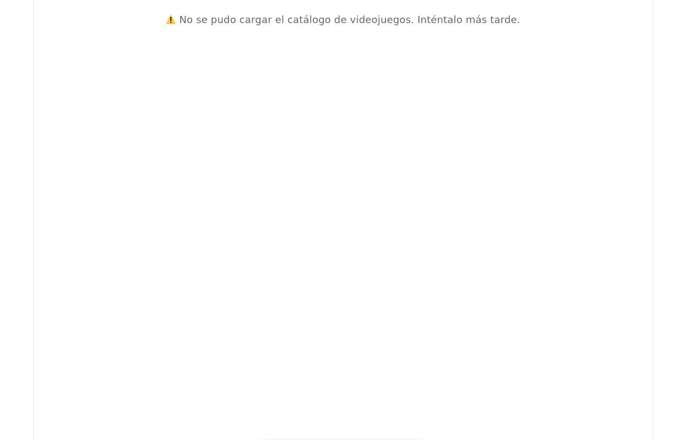
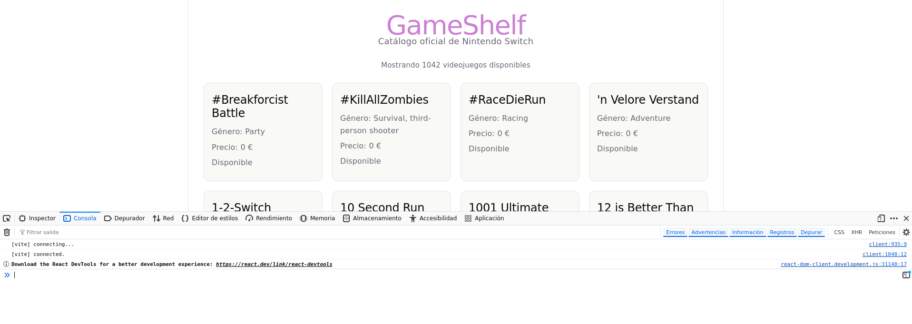

## Qué es Axios y para qué se utiliza

Axios es una popular librería de JavaScript basada en promesas que actúa como un cliente HTTP. En términos sencillos, es el "mensajero" digital que utiliza tu aplicación frontend (como React) para comunicarse con servidores externos y APIs a través de internet.

## Qué es una dependencia, qué función tiene npm y qué contiene `node_modules`

- Una dependencia es un paquete de código externo o librería desarrollado por terceros (en este caso, Axios) que tu aplicación requiere obligatoriamente para funcionar. En lugar de escribir desde cero el código para conectarte a internet, "dependes" de una librería ya testeada y optimizada.

- `npm` es el Gestor de Paquetes de Node. Funciona como una herramienta de línea de comandos y, a la vez, como un enorme mercado en la nube repleto de herramientas compartidas por programadores de todo el mundo. Su función es automatizar la descarga, actualización, desinstalación y configuración de todas las dependencias que listes en tu archivo package.json.

- `node_modules` contiene los archivos físicos con el código fuente de Axios y de cualquier otra librería que use tu proyecto. Además de la carpeta de Axios, verás decenas de carpetas adicionales: son las "dependencias de tus dependencias" (el código secundario que Axios u otras librerías necesitan internamente para hacer su trabajo).

## Qué cambió en `package.json`, qué hace Axios y qué descubrimos sobre esos archivos y herramientas

Al instalar la librería, se añadió automáticamente un nuevo registro dentro del objeto `"dependencies"`. Visualmente, tu archivo ahora muestra una línea similar a esta:

```
"dependencies": {
    "axios": "^1.20.0",
    "react": "^19.2.8",
    "react-dom": "^19.2.8"
  },
```

Su trabajo principal es ir a buscar los datos de los videojuegos, convertirlos automáticamente a objetos de JavaScript (sin que tengas que transformarlos manualmente a JSON) y entregártelos listos para guardarlos en el estado de React (`useState`).

Al instalar Axios con el comando npm install axios, pusiste en marcha el motor de dependencias de Node.js y pudiste comprobar cómo cooperan estos tres elementos:

- `npm` (Node Package Manager): Descubriste que es el administrador y el instalador automático del proyecto. Se encarga de buscar la librería Axios en internet, descargarla de forma segura y acomodarla en tu entorno de desarrollo.

- `package.json`: Es el inventario o "manual de instrucciones" de tu aplicación. Descubriste que tras la instalación, se modificó solo para añadir a "axios" en la sección de "dependencies". Esto le dice a cualquier otro programador (o a ti mismo en el futuro) qué librerías externas se necesitan exactamente para que el proyecto encienda.

- `node_modules/`: Es el almacén físico del proyecto. Descubriste que allí dentro se descargó el código real de Axios junto con cientos de otras carpetas de soporte. Al ser un espacio automatizado por npm y extremadamente pesado, aprendiste la regla de oro: nunca se debe editar a mano ni subir a plataformas como GitHub, ya que se puede regenerar limpiamente en cualquier ordenador ejecutando el comando `npm install`.

## Preguntas


**1. ¿Cómo se importa Axios en un archivo TypeScript?**

Para utilizar Axios en cualquier componente de React con TypeScript, se debe importar en la parte superior del archivo con la siguiente línea de código:

`import axios from 'axios';`

**2. ¿Cómo se solicita información con una petición GET?**

Se solicita utilizando el método `.get()` de Axios, pasándole como argumento la dirección URL (o endpoint) del servidor al que queremos consultar. En un entorno moderno se escribe así:

`const respuesta = await axios.get("https://sampleapis.com");
`

**3. ¿Qué devuelve Axios y dónde están los datos de la respuesta?**

Axios devuelve un objeto contenedor de respuesta `HTTP` (que incluye información como el código de `estado` status y las cabeceras `headers`).

Los datos reales y útiles devueltos por el servidor (en este caso, la lista de videojuegos) se encuentran estrictamente dentro de la propiedad `.data` de ese objeto (por ejemplo: `respuesta.data`).

**4. ¿Qué significa que una operación sea asíncrona? ¿Qué son una promesa, async y await?**

- **Operación asíncrona**: Es una tarea que tarda un tiempo en completarse (como traer datos por internet). En lugar de congelar la aplicación mientras espera, el programa continúa ejecutando otras líneas de código en segundo plano.

- **Promesa**: Es un objeto especial en JavaScript que representa el "resultado futuro" de esa operación asíncrona. Promete que en algún momento terminará con éxito (dando los datos) o con fallo (dando un error).

- `async`: Es una palabra clave que se coloca antes de una función para avisarle a JavaScript que dentro de ella habrá tareas asíncronas que tardarán en responder.

- `await`: Es una palabra clave que solo se puede usar dentro de funciones `async`. Le dice al código: "Espera pacientemente en esta línea hasta que la promesa se resuelva (lleguen los datos de Axios) antes de continuar con la siguiente línea".

**5. ¿Cómo puede React guardar los datos recibidos y actualizar la página?**

React utiliza el hook `useState`. Las variables normales de JavaScript no tienen la capacidad de redibujar la pantalla. `useState` te proporciona una variable para almacenar los videojuegos y una función modificadora (ej. `setGames`). Cuando llamas a esa función con los datos nuevos de la API, React detecta el cambio automáticamente y vuelve a renderizar (actualizar) la página en el navegador.

**6. ¿Cómo se inicia una operación externa, como una petición, cuando se muestra un componente?**

Se utiliza el hook `useEffect` configurado con un array de dependencias vacío `[]` al final. Esto le indica a React que debe ejecutar la petición de Axios una sola vez, justamente en el instante en el que el componente se monta y aparece por primera vez en la pantalla del usuario.

**7. ¿Cómo se recorre una lista para mostrar un elemento por videojuego?**

Se utiliza el método interactivo `.map()` de JavaScript dentro del código JSX. Este método recorre el array de datos elemento por elemento y transforma cada videojuego en un componente visual (como un `<li>` o tu `<GameCard />`). Es obligatorio asignarle un atributo único `key` (como `key={game.id}`) para que React rastree los elementos eficientemente.

```
{games.map((game) => (
  <GameCard key={game.id} title={game.name} genre={game.genre.join(", ")} />
))}
```

**8. Como el proyecto usa TypeScript, ¿qué tipo describe los juegos? Basa sus propiedades en el JSON que has observado.**

Basándonos en la estructura real que devuelve el JSON de la API de SampleAPIs para Nintendo Switch, el tipo (`type`) en TypeScript se define modelando las propiedades exactas y sus tipos de datos correspondientes:

```
type Game = {
  id: number;        // Un número identificador único
  name: string;      // Una cadena de texto con el título del juego
  genre: string[];   // Un array/lista de cadenas de texto con los géneros del juego
};
```

**9. ¿Cómo puedes limitar la cantidad de juegos que muestras?**

Se utiliza el método de arrays `.slice()` justo antes de aplicar el `.map()`. Este método extrae una sección del array sin modificar el original. Por ejemplo, si quieres limitar la lista para mostrar únicamente los primeros 5 videojuegos de la API, escribirías en tu renderizado:

```
games.slice(0, 5).map((game) => ( ... ))
```

## Comprobaciones

- La aplicación se inicia.
- Aparecen juegos después de recibir la respuesta.
- Los nombres y géneros vienen de la API.

<br>


- Se ve algún indicador mientras carga.

<br>


- Hay un mensaje claro si falla la petición.

<br>



- La consola del navegador no muestra errores.

<br>

