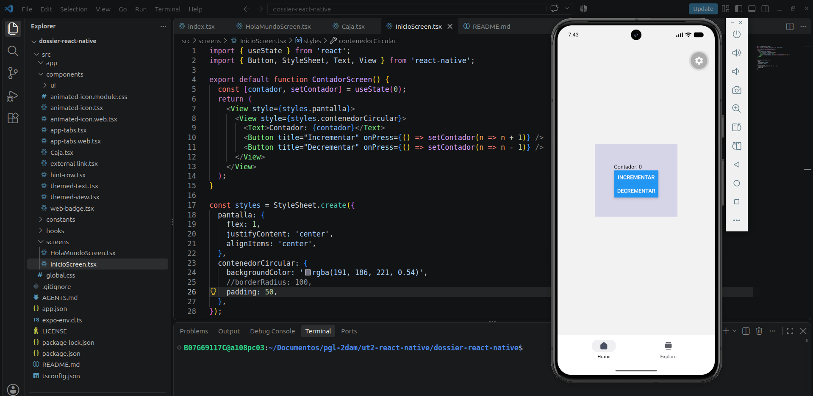
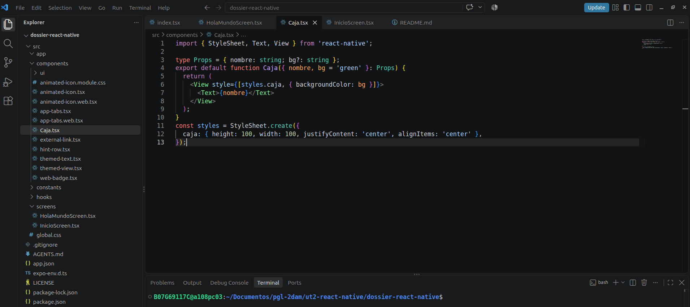
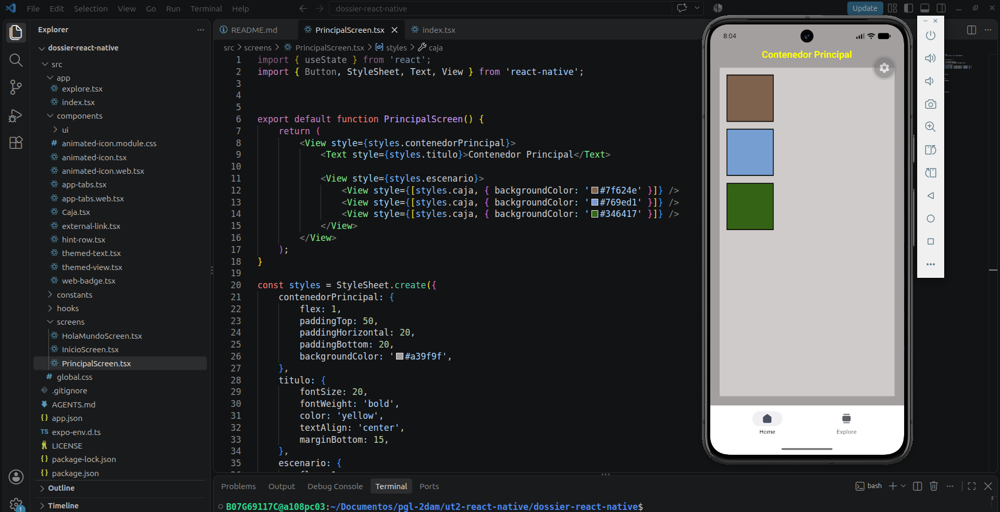
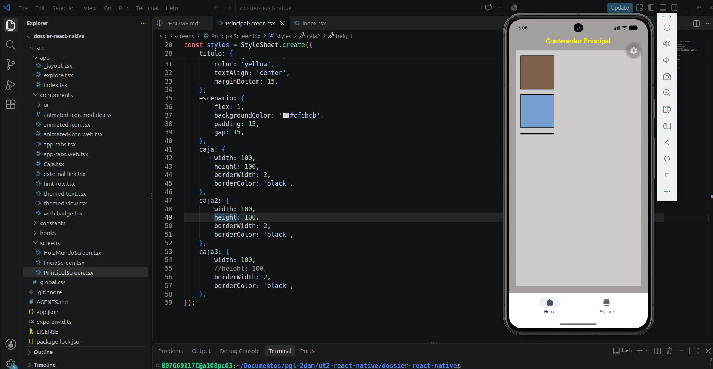
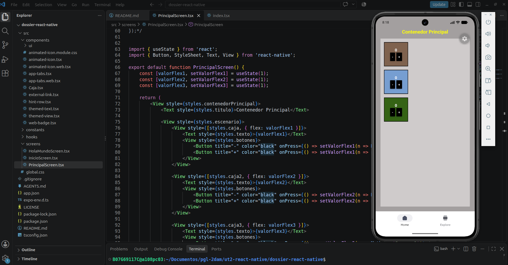
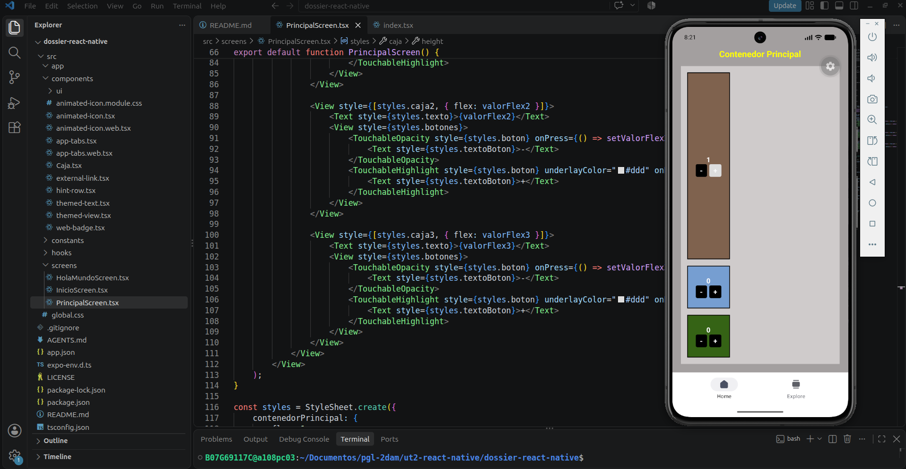

# Dossier de React Native con Expo y Android Studio

Atteneri Bravo Barroso

2ºDAM

## Configuración

**PENDIENTE**: añadir demás comandos

En la terminal, desde la carpeta donde he guardado el proyecto ejecuto:

```bash
npx create-expo-app@latest dossier-react-native --template default
cd dossier-react-native
code .
npx expo start
```

El creador de proyectos instalará Expo, TypeScript y la estructura de rutas de Expo Router. Si os pide confirmar la instalación, aceptad. Con el emulador de Android ya iniciado, pulsad **`a`** en la terminal del servidor de Expo. Si la aplicación no se abre, comprobad el dispositivo con `adb devices` y volved a arrancar el servidor.

> Las plantillas y su estructura evolucionan. Si el proyecto inicial incluye pantallas demostrativas, seguid la guía de limpieza de la plantilla que indique vuestra versión de Expo; conservad `src/app/_layout.tsx` y `src/app/index.tsx` (o `app/` cuando la plantilla no use `src/`). A partir de aquí, todos los ejemplos del dossier consideran `src/app/`.

**Archivos básicos:** `package.json` enumera scripts y dependencias; `app.json` contiene la configuración de Expo; `tsconfig.json` configura TypeScript; `assets/` almacena imágenes; `src/app/` contiene las rutas de navegación.


## Práctica 1. Hola Mundo

En `src/app/index.tsx` cread una pantalla que muestre el mensaje «¡Hola mundo! Soy [vuestro nombre]». Utilizad un `View` y un `Text`; aplicad fondo rosa, `flex: 1`, `justifyContent: 'center'` y `alignItems: 'center'`.

```tsx
import { StyleSheet, Text, View } from 'react-native';

export default function Index() {
  return (
    <View style={styles.pantalla}>
      <Text>¡Hola mundo! Soy ...</Text>
    </View>
  );
}

const styles = StyleSheet.create({
  pantalla: {
    alignItems: 'center',
    backgroundColor: 'lightpink',
    flex: 1,
    justifyContent: 'center',
  },
});
```


## Componentes básicos y layout

### `View`, `Text` y `Button`

`View` es un contenedor visual; equivale a una caja capaz de agrupar otros componentes. `Text` sirve para mostrar texto: no podemos escribir cadenas directamente dentro de un `View` sin envolverlas en `Text`. `Button` presenta un botón nativo con propiedades básicas: `title`, `onPress`, `color` y `accessibilityLabel`.

Estos componentes se importan desde `react-native`, **también al usar Expo**. Un estado creado con `useState` permite actualizar la pantalla cuando cambia su valor:

```tsx
import { useState } from 'react';
import { Button, StyleSheet, Text, View } from 'react-native';

export default function ContadorScreen() {
  const [contador, setContador] = useState(0);
  return (
    <View style={styles.caja}>
      <Text>Contador: {contador}</Text>
      <Button title="Incrementar" onPress={() => setContador(n => n + 1)} />
    </View>
  );
}
const styles = StyleSheet.create({
  caja: { alignItems: 'center', borderWidth: 2, padding: 20 },
});
```

Cuando se pulsa el botón, `setContador` actualiza el estado y React vuelve a representar el componente. No es necesario modificar manualmente el texto de la pantalla.


### Práctica 2. Contador con dos botones

Partiendo del ejemplo anterior, cambiad el color del borde y del fondo, redondead las esquinas con `borderRadius` e incorporad otro botón que decremente el contador. Mostrad el valor en un `Text` y comprobad el resultado en Android Studio.

**Cómo resolverla:** utilizad el mismo estado `contador` y dos funciones `onPress`, una con `setContador(n => n + 1)` y otra con `setContador(n => n - 1)`. Personalizad el contenedor mediante `StyleSheet.create()`; el `Button` nativo no admite la misma personalización que un `View`.

### Separar pantallas, componentes y estilos

Hasta ahora habéis escrito todo en un único archivo. En las siguientes prácticas separaremos los componentes reutilizables (`src/components/`) de las pantallas completas (`src/screens/`). Las pantallas que se abren desde Expo Router necesitan, además, un archivo de ruta dentro de `src/app/`.

`StyleSheet.create()` permite guardar estilos reutilizables y evita llenar el JSX de objetos repetidos:

```tsx
const styles = StyleSheet.create({
  contenedorCircular: {
    backgroundColor: 'rgba(191, 186, 221, 0.54)',
    borderRadius: 100,
    padding: 20,
  },
});
// En el JSX: <View style={styles.contenedorCircular}>...</View>
```

Podéis instalar extensiones de fragmentos de código (*snippets*), pero los atajos concretos dependen de la extensión: no son comandos de Expo.

---


### Práctica 3. `InicioScreen` y estilos separados

Cread `src/screens/InicioScreen.tsx` para colocar el contador de la práctica 2. En `src/app/index.tsx`, importad y mostrad `<InicioScreen />`. Los estilos deberán declararse mediante `StyleSheet.create()`.

**Para conservar las prácticas:** en este momento podéis guardar el «Hola mundo» como `src/screens/HolaMundoScreen.tsx`. Después crearemos un índice de rutas para abrir cada pantalla por separado; no eliminéis el código del primer ejercicio. `src/screens/` contiene la implementación y `src/app/` actuará como enlace a ella cuando configuremos las rutas.

```tsx
// src/app/index.tsx (hasta crear el menú general)
import InicioScreen from '../screens/InicioScreen';
export default function Index() {
  return <InicioScreen />;
}
```

Revisad que ambos archivos funcionen, que no haya errores de importación y que el contador conserve su comportamiento.



---


### Layout con Flexbox

React Native emplea Flexbox para distribuir componentes. Frente al CSS del navegador, los contenedores se organizan **en columna por defecto** (`flexDirection: 'column'`) y no necesitan `display: 'flex'`. Las unidades numéricas de `width`, `height`, `margin` o `padding` se expresan normalmente como unidades lógicas, sin añadir `px`.

Con `flex: 1` un contenedor ocupa el espacio libre. `flexDirection: 'row'` coloca los hijos en horizontal y `flexDirection: 'column'` los coloca en vertical.

```tsx
// src/components/Caja.tsx
import { StyleSheet, Text, View } from 'react-native';

type Props = { nombre: string; bg?: string };
export default function Caja({ nombre, bg = 'green' }: Props) {
  return (
    <View style={[styles.caja, { backgroundColor: bg }]}>
      <Text>{nombre}</Text>
    </View>
  );
}
const styles = StyleSheet.create({
  caja: { height: 100, width: 100, justifyContent: 'center', alignItems: 'center' },
});
```

La sintaxis `style={[styles.caja, { backgroundColor: bg }]}` combina un estilo base y un valor personalizado, también se puede utilizar la extensión de objetos con `...styles.caja`.



---

### Práctica 4. Tres cajas

Cread una pantalla `PrincipalScreen` con el texto «Contenedor Principal» y un `View` para el escenario. Dentro colocad tres componentes `Caja` de 100 × 100 y enviadles colores diferentes mediante propiedades. El escenario debe tener `flex: 1`.



---


### Reparto del espacio con `flex`

`flex` controla cómo se reparte el espacio libre entre elementos hermanos. Dos hijos con `flex: 1` comparten ese espacio; si uno tiene `flex: 2`, recibe el doble de la parte asignada al que tiene `flex: 1`, siempre que las restantes restricciones de tamaño lo permitan.

**Atención:** si una caja tiene `height: 100`, el efecto de `flex` puede verse condicionado por esa altura. Para observar claramente el reparto en la siguiente práctica, podéis usar una variante de la caja sin altura fija.



---

### Práctica 5. Modificar `flex` dinámicamente

Añadid a cada caja dos botones: uno incrementará su valor de `flex` y otro lo disminuirá. Mostrad el valor actual de cada caja y comprobad cómo se reorganiza el espacio. Guardad los valores en estados independientes y evitad valores negativos cuando no tengan sentido para vuestro diseño.

```tsx
const [valorFlex, setValorFlex] = useState(0);
// Aplicad { flex: valorFlex } al contenedor de la caja.
// Botones: setValorFlex(n => n + 1) y setValorFlex(n => Math.max(0, n - 1)).
```

El resultado debe seguir siendo consultable cuando paséis a los siguientes ejercicios.



---


### `TouchableOpacity` y `TouchableHighlight`

Los botones nativos permiten poca personalización. React Native incluye componentes que reaccionan al tacto y pueden envolver una interfaz personalizada. `TouchableOpacity` reduce la opacidad al pulsar; `TouchableHighlight` muestra un resaltado. Ambos utilizan `onPress`.

```tsx
import { Alert, Text, TouchableHighlight, TouchableOpacity } from 'react-native';

<TouchableHighlight onPress={() => Alert.alert('Pulsado')} underlayColor="#ddd">
  <Text>Botón destacado</Text>
</TouchableHighlight>

<TouchableOpacity onPress={() => Alert.alert('Pulsado')}>
  <Text>Botón con opacidad</Text>
</TouchableOpacity>
```

En aplicaciones actuales también puede utilizarse `Pressable`, pero para observar las diferencias entre los componentes táctiles trabajaremos aquí con los dos componentes anteriores.

