# Dossier de React Native con Expo y Android Studio

**Atteneri Bravo Barroso** · 2.º DAM · Programación Multimedia y Dispositivos Móviles

En este repositorio voy recogiendo las prácticas del bloque de React Native. Todas viven en **un único proyecto Expo** (`dossier-react-native`). No borro las anteriores al avanzar: cada ejercicio queda accesible desde un índice en la pantalla principal. Por cada práctica explico qué he hecho, qué problemas me han salido y en qué estado está.

> **PENDIENTE:** completar los comandos y revisar las capturas de cada práctica.

---

## Configuración

### Herramientas

Para trabajar he necesitado Node.js (versión LTS), Visual Studio Code, Git con mi cuenta de GitHub y Android Studio con su emulador. Una vez arrancado el emulador desde el Device Manager, compruebo que lo detecta el sistema con:

```bash
adb devices
```

Debe aparecer un dispositivo en estado `device`.

### Crear el proyecto

Desde la carpeta donde guardo mis proyectos ejecuto:

```bash
npx create-expo-app@latest dossier-react-native --template default
cd dossier-react-native
code .
npx expo start
```

La plantilla instala Expo, TypeScript y Expo Router. Con el emulador ya encendido, pulso **`a`** en la terminal del servidor para que se abra la app. Si no arranca, reviso `adb devices` y reinicio el servidor.

Como la plantilla inicial trae pantallas de ejemplo, las he limpiado dejando solo `src/app/_layout.tsx` y `src/app/index.tsx`. A partir de aquí todas mis rutas cuelgan de `src/app/`.

### Archivos principales

| Archivo / carpeta | Para qué sirve |
|---|---|
| `package.json` | Scripts y dependencias del proyecto |
| `app.json` | Configuración de Expo |
| `tsconfig.json` | Configuración de TypeScript |
| `assets/` | Imágenes y otros recursos |
| `src/app/` | Rutas de navegación (Expo Router) |

---

## Práctica 1. Hola mundo

Una pantalla en `src/app/index.tsx` que muestra «¡Hola mundo! Soy Atteneri». Uso un `View` como contenedor y un `Text` para el mensaje. El contenedor ocupa toda la pantalla (`flex: 1`), está centrado en ambos ejes y tiene fondo rosa.

```tsx
import { StyleSheet, Text, View } from 'react-native';

export default function Index() {
  return (
    <View style={styles.pantalla}>
      <Text>¡Hola mundo! Soy Atteneri</Text>
    </View>
  );
}

const styles = StyleSheet.create({
  pantalla: {
    alignItems: 'center',
    backgroundColor: 'lightpink',
    flex: 1,
    justifyContent: 'center',
  },
});
```

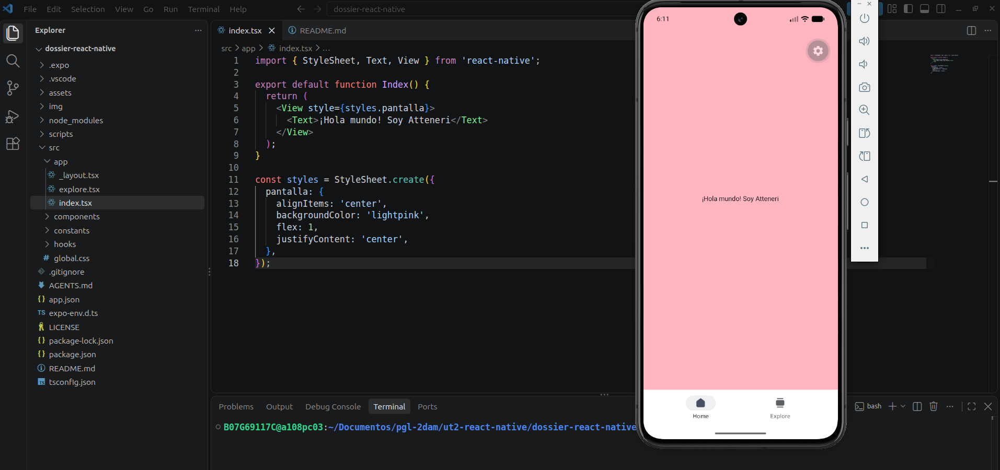

---

## Componentes básicos y layout

### `View`, `Text` y `Button`

Lo que he entendido de estos tres componentes:

- `View` es la caja que agrupa a otros componentes.
- `Text` es el único sitio donde puede ir texto; no se puede escribir una cadena suelta dentro de un `View`.
- `Button` es el botón nativo. Solo admite `title`, `onPress`, `color` y `accessibilityLabel`, así que personalizarlo es limitado.

Los tres se importan de `react-native`, también cuando se usa Expo, porque Expo no sustituye a React Native sino que lo complementa.

Para que la pantalla cambie al interactuar uso `useState`. Al pulsar el botón se actualiza el estado y React vuelve a pintar el componente solo; no hay que tocar el texto a mano.

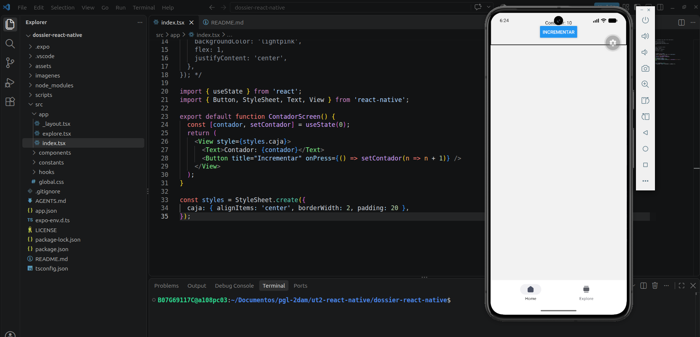

### Práctica 2. Contador con dos botones

He ampliado el contador anterior con un segundo botón que resta 1. Ambos comparten el mismo estado `contador`: uno llama a `setContador(n => n + 1)` y el otro a `setContador(n => n - 1)`. Además he cambiado el color del borde y del fondo y he redondeado las esquinas con `borderRadius`. Esos estilos van en el `View` contenedor, porque el `Button` nativo no deja personalizarse de esa forma.

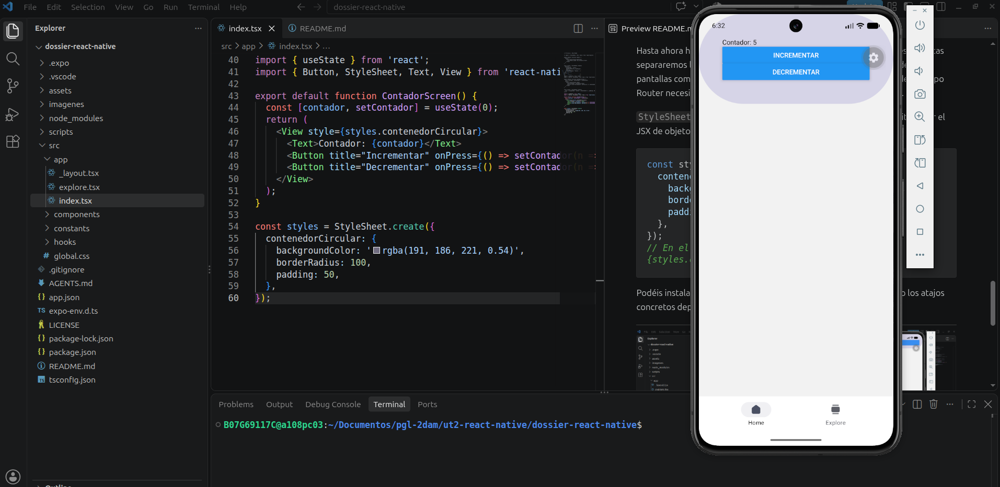

### Separar pantallas, componentes y estilos

Hasta aquí todo estaba en un solo archivo. Ahora separo el código en:

- `src/screens/` → pantallas completas.
- `src/components/` → piezas reutilizables.
- `src/app/` → solo los archivos de ruta que enlazan con las pantallas.

Los estilos los agrupo con `StyleSheet.create()` para no llenar el JSX de objetos repetidos. Los atajos de código (*snippets*) dependen de la extensión de VS Code que se instale; no son un comando de Expo.


### Práctica 3. `InicioScreen` y estilos separados

1. Creé `src/screens/InicioScreen.tsx` con el contador de la práctica 2 y sus estilos en `StyleSheet.create()`.
2. En `src/app/index.tsx` importo y muestro `<InicioScreen />`.
3. Moví el «Hola mundo» a `src/screens/HolaMundoScreen.tsx` para no perderlo.

```tsx
// src/app/index.tsx (provisional, hasta tener el índice de prácticas)
import InicioScreen from '../screens/InicioScreen';

export default function Index() {
  return <InicioScreen />;
}
```

Comprobé que no hay errores de importación y que el contador sigue funcionando igual.


---

### Layout con Flexbox

React Native distribuye los elementos con Flexbox, pero con diferencias respecto al CSS del navegador:

- La dirección por defecto es **columna** (`flexDirection: 'column'`).
- No hace falta escribir `display: 'flex'`.
- Las medidas son números sin `px`.

`flex: 1` hace que un contenedor ocupe el espacio libre; `flexDirection: 'row'` coloca a los hijos en horizontal.

Para probarlo creé un componente `Caja` que recibe un nombre y un color de fondo opcional (verde si no se indica):

```tsx
// src/components/Caja.tsx
type Props = { nombre: string; bg?: string };

export default function Caja({ nombre, bg = 'green' }: Props) {
  return (
    <View style={[styles.caja, { backgroundColor: bg }]}>
      <Text>{nombre}</Text>
    </View>
  );
}
```

Con `style={[styles.caja, { backgroundColor: bg }]}` mezclo el estilo base con el valor que llega por props.

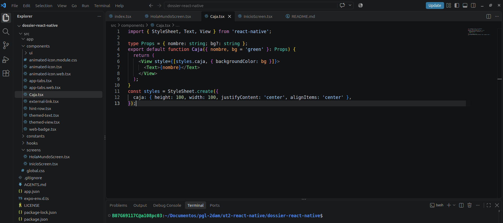

### Práctica 4. Tres cajas

Una pantalla `PrincipalScreen` con el texto «Contenedor Principal» y un `View` escenario con `flex: 1`. Dentro coloco tres `Caja` de 100 × 100, cada una con un color distinto pasado por props.


---

### Reparto del espacio con `flex`

`flex` decide cómo se reparten el espacio libre los elementos hermanos. Si dos hijos tienen `flex: 1`, se lo reparten a partes iguales; si uno tiene `flex: 2`, recibe el doble que el otro.

Ojo: si la caja tiene `height: 100` fijo, esa altura limita el efecto de `flex`. Por eso para la práctica siguiente usé una variante de la caja sin altura fija.


### Práctica 5. Modificar `flex` dinámicamente

Cada caja tiene su propio estado `valorFlex` y dos botones (+ y −). El valor se muestra en la caja y se aplica como `flex` en su contenedor, así que el espacio se reorganiza al pulsar. Al restar uso `Math.max(0, n - 1)` para que nunca baje de cero.

```tsx
const [valorFlex, setValorFlex] = useState(0);
// +: setValorFlex(n => n + 1)
// −: setValorFlex(n => Math.max(0, n - 1))
```

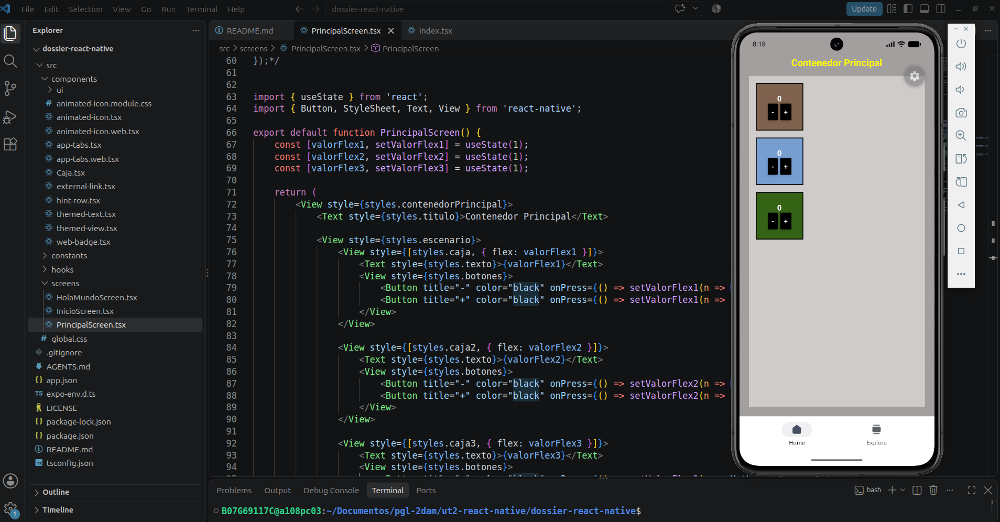

---

### `TouchableOpacity` y `TouchableHighlight`

El `Button` nativo se personaliza poco, así que React Native ofrece componentes táctiles que envuelven cualquier interfaz:

- `TouchableOpacity` baja la opacidad mientras se pulsa.
- `TouchableHighlight` muestra un color de resaltado (`underlayColor`).

Los dos usan `onPress`. Existe también `Pressable`, más moderno, pero aquí uso estos dos para ver sus diferencias.

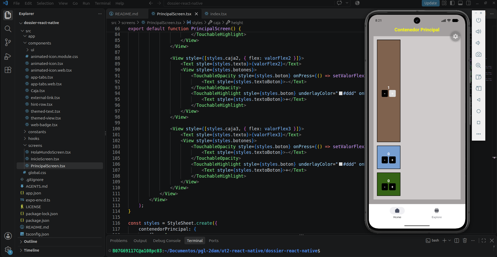

### Práctica 6. Sustituir los botones

En la práctica 5 cambié los botones. El de `flex + 1` es un `TouchableHighlight` que muestra una alerta y sube el valor; el de `flex - 1` es un `TouchableOpacity` que lo baja. A ambos les di un aspecto propio con estilos.


---

### Estilos recibidos por props

Para que quien use `Caja` pueda personalizarla, añado una prop `style` de tipo `StyleProp<ViewStyle>` y la combino con el estilo por defecto: `[styles.porDefecto, style]`. Cuando una propiedad está en los dos, gana la del segundo. Así reutilizo el mismo componente sin duplicar código.

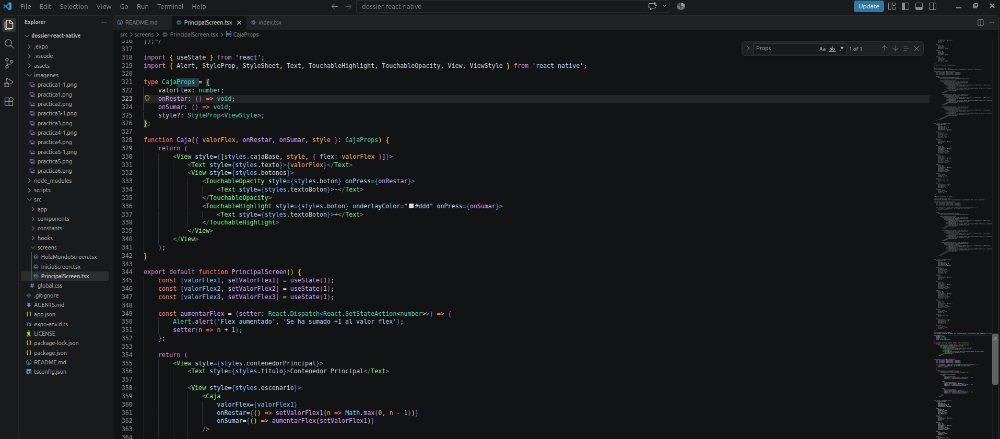

### Práctica 7. Nombre y estilos personalizados

Cada caja muestra su nombre (Caja A, B y C) y acepta estilos por props. La Caja B tiene las esquinas redondeadas y un borde distinto al resto.


---

### `flexWrap` y `flexDirection`

- `flexWrap: 'wrap'` hace que los hijos salten a la siguiente línea cuando no caben (por defecto es `'nowrap'`).
- `flexDirection` admite `row`, `column`, `row-reverse` y `column-reverse`.

Cuando genero elementos con `map`, cada uno necesita una `key` estable.


### Práctica 8. Círculos dinámicos

Parto de un escenario vacío. Un botón añade un círculo con un color generado; otros dos botones alternan `wrap`/`nowrap` y `row`/`column`. Los tres controles son `TouchableOpacity` personalizados. Para que ningún canal RGB pase de 255 limito el cálculo con `Math.min(255, valor)`.

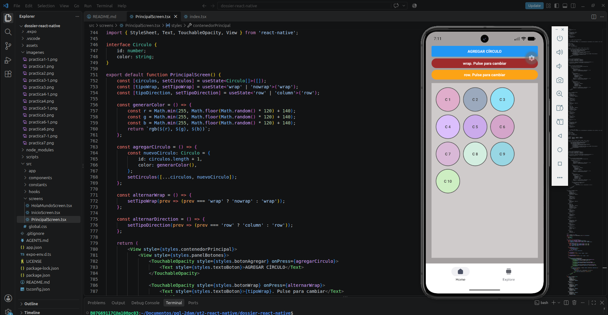

---

### `justifyContent`, `alignItems`, `TextInput` e `Image`

- `justifyContent` reparte los elementos por el **eje principal** (el que marca `flexDirection`).
- `alignItems` los alinea en el **eje transversal**.

Ejemplo con columna: `space-around` reparte el espacio en vertical y `center` los centra en horizontal.

`TextInput` se controla con `value`, `onChangeText`, `placeholder` y `style`, y su valor sale de un estado. Antes de usar lo escrito como `justifyContent` hay que comprobar que es un valor permitido; en TypeScript lo mejor es definir un tipo unión con esos valores.

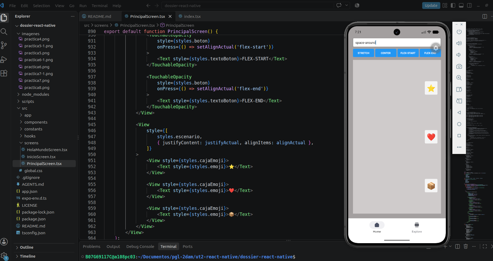

### Contenedores anidados e imágenes

Cada contenedor puede tener su propia dirección. Por ejemplo, un `View` en columna puede contener otro en fila para una hilera de botones.

`Image` carga:

- imágenes **remotas** con `source={{ uri: '...' }}`;
- imágenes **locales** con `require('ruta')`. La ruta tiene que ser fija: no se puede construir con una variable, porque el empaquetador necesita conocer los archivos al compilar.

Comprobé las rutas con los nombres reales de mis archivos, y para las remotas evito enlaces que puedan caducar.

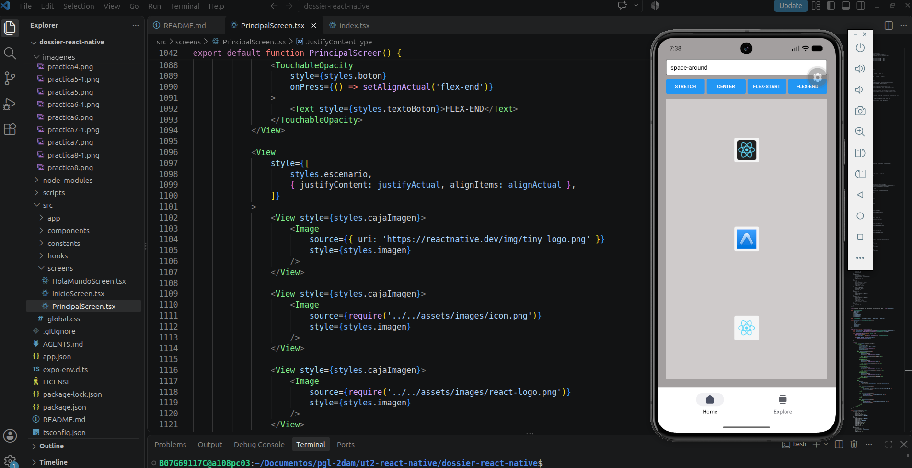


### Práctica 9. Distribución, alineación e imágenes

Una pantalla con un campo de texto para escribir un valor válido de `justifyContent`, botones para cambiar `alignItems` y tres imágenes (al menos una cargada con `require`). Uso `flexWrap: 'nowrap'` para ver bien el efecto de las alineaciones y muestro en pantalla cuál está activa.


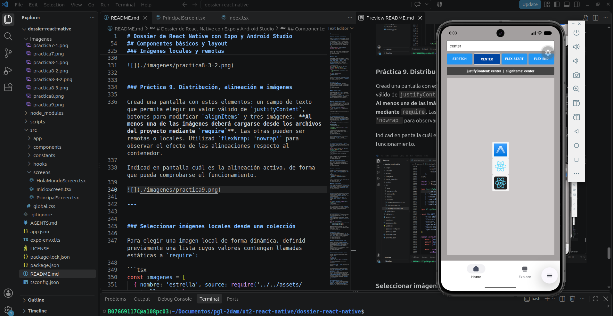

---

### Elegir una imagen local desde una colección

Para elegir imágenes locales de forma dinámica, guardo en una lista objetos cuyo `source` ya lleva el `require` escrito. Así el índice seleccionado (guardado en un estado) decide cuál se muestra. Los archivos de la lista tienen que existir antes de ejecutar.


### Práctica 9.1. Imagen aleatoria

Con una colección de imágenes locales, un botón elige una al azar con `Math.floor(Math.random() * imagenes.length)` y guarda el índice con `useState`.

### Áreas seguras

Para que el contenido no quede debajo de la barra de estado de Android uso `SafeAreaView` importado de **`react-native-safe-area-context`**, no el de `react-native`, que está obsoleto.


---

### Más propiedades de layout

Otras propiedades que he visto: `gap`, `rowGap` y `columnGap` para separar elementos; `alignContent` para repartir líneas con `wrap`; `position` (`relative` o `absolute`); y en `Text`, `adjustsFontSizeToFit` y `numberOfLines` para que un resultado largo quepa en el ancho disponible.

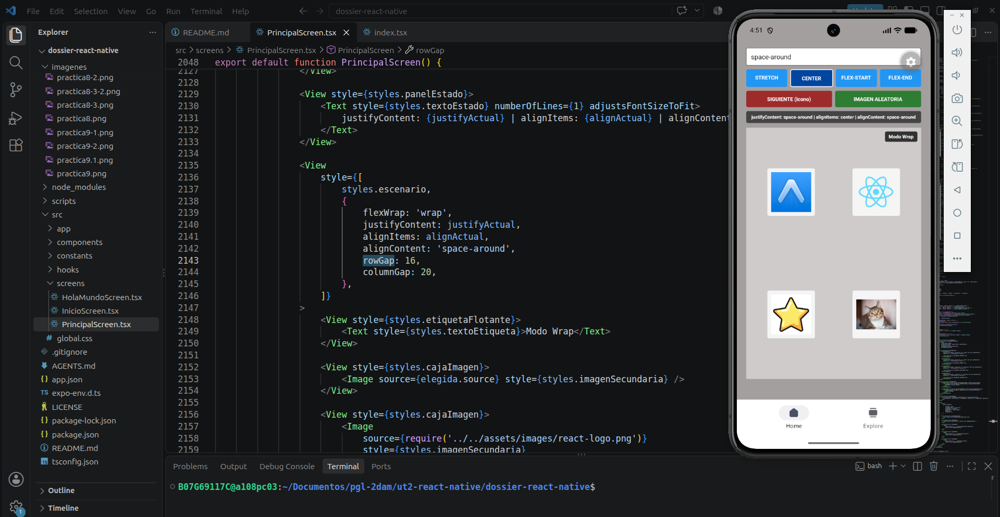

### Práctica 10. Calculadora

Una calculadora con pantalla de resultado y filas de teclas numéricas y de operaciones, distribuidas con Flexbox. El resultado se guarda en un estado. Cada tecla es un componente reutilizable (`TeclaCalculadora.tsx`) basado en `TouchableOpacity`, y la interfaz está en `CalculadoraScreen.tsx`. No uso `eval` para calcular.

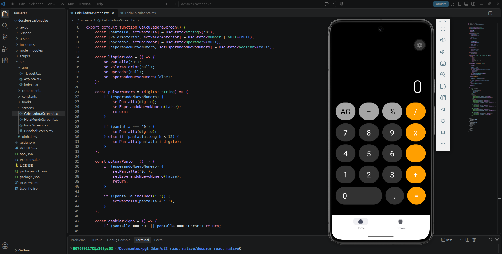

---

## Estructura de carpetas

Después de las primeras prácticas organizo el proyecto de esta manera, y solo creo carpetas cuando las necesito:

```text
src/
├── app/
│   ├── _layout.tsx
│   ├── index.tsx                # Índice general de prácticas
│   ├── practica01.tsx
│   ├── practica02.tsx
│   └── ...
├── screens/                     # Pantallas con la implementación
├── components/                  # Componentes reutilizables
├── hooks/                       # Hooks personalizados
├── context/                     # Estados compartidos
├── api/                         # Peticiones HTTP
├── db/                          # SQLite y consultas
├── navigation/                  # Ayudas de navegación
└── theme/                       # Estilos, colores y constantes
assets/                          # Imágenes y recursos
```

Los archivos de `src/app/` son **rutas de Expo Router**. Cada uno exporta una pantalla que está implementada en `src/screens/`, por ejemplo:

```tsx
export { default } from '../screens/InicioScreen';
```

Para ejercicios con varias pantallas (Stack, Drawer o Tabs) crearé una carpeta de rutas propia con su `_layout.tsx`.

### Índice de prácticas

Para no perder las prácticas 1–10, `src/app/index.tsx` es ahora un índice con un enlace a cada ejercicio:

```tsx
import { Link } from 'expo-router';
import { ScrollView, Text } from 'react-native';

export default function Index() {
  return (
    <ScrollView contentContainerStyle={{ padding: 20, gap: 16 }}>
      <Text>Prácticas de React Native con Expo</Text>
      <Link href="/practica01">Práctica 1</Link>
      <Link href="/practica02">Práctica 2</Link>
    </ScrollView>
  );
}
```

Cada enlace apunta a un archivo real (por ejemplo, `src/app/practica01.tsx` exporta `HolaMundoScreen`) y voy ampliando la lista con cada práctica nueva. No dejo componentes auxiliares sueltos dentro de `src/app/`, porque Expo Router los interpretaría como rutas.

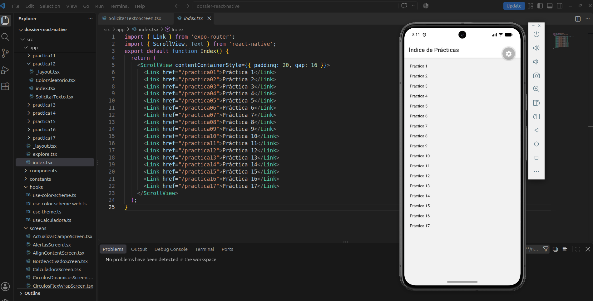

---

### Práctica 11. Hook personalizado para la calculadora

Extraed de la calculadora las variables de estado y las funciones que no forman parte del JSX a un hook `src/hooks/useCalculadora.ts`. La pantalla importará el hook y utilizará los valores y funciones que este devuelva. Comprobad que la calculadora sigue funcionando.

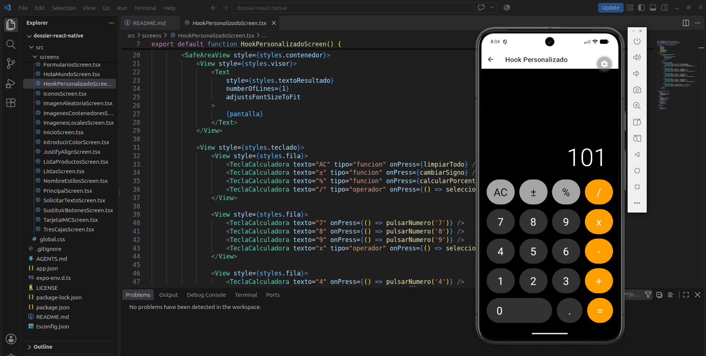

---


## Formularios, Switch, Alert/Prompt

### Alertas

`Alert.alert()` muestra un diálogo nativo para informar al usuario o solicitar una confirmación. Acepta un título, un mensaje y botones con funciones asociadas:

```tsx
import { Alert } from 'react-native';
Alert.alert('Cambiar color', '¿Aplicar el nuevo fondo?', [
  { text: 'Cancelar', style: 'cancel' },
  { text: 'Aceptar', onPress: () => setFondo(colorPropuesto) },
]);
```

El cambio se produce al pulsar «Aceptar»; si se cancela, el estado no se modifica.

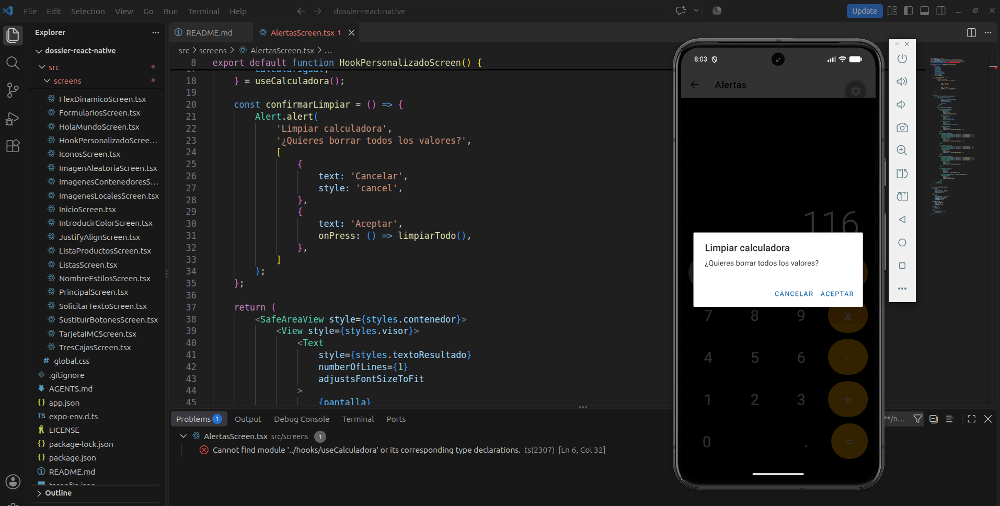

---

### Práctica 12. Color aleatorio con confirmación

Cread una pantalla con un botón «Cambiar de color». Al pulsarlo elegid aleatoriamente un color de una lista y mostrad una alerta indicando cuál se propone. Si se acepta, cambiad el fondo; si se cancela, conservad el anterior.

Para solicitar texto dentro de un diálogo en Android, crearemos un componente compatible con Expo en lugar de depender de un paquete nativo de terceros.

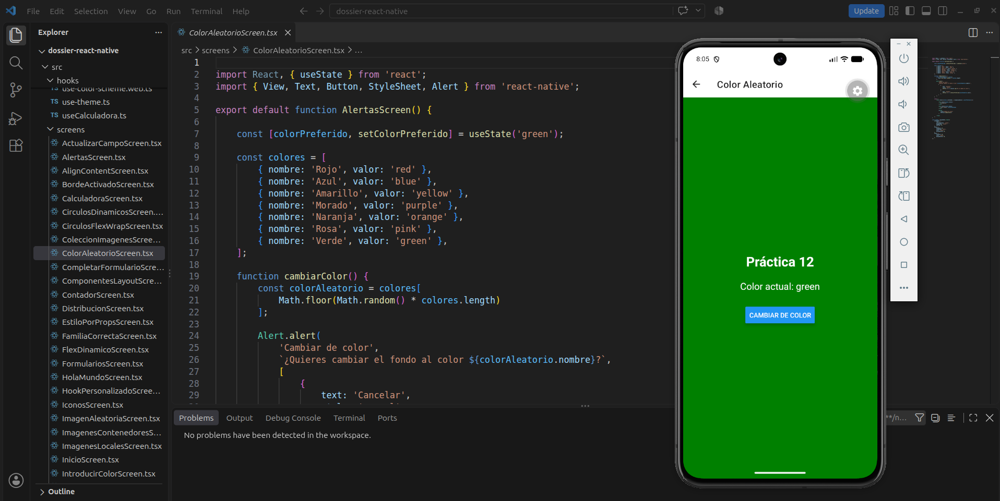

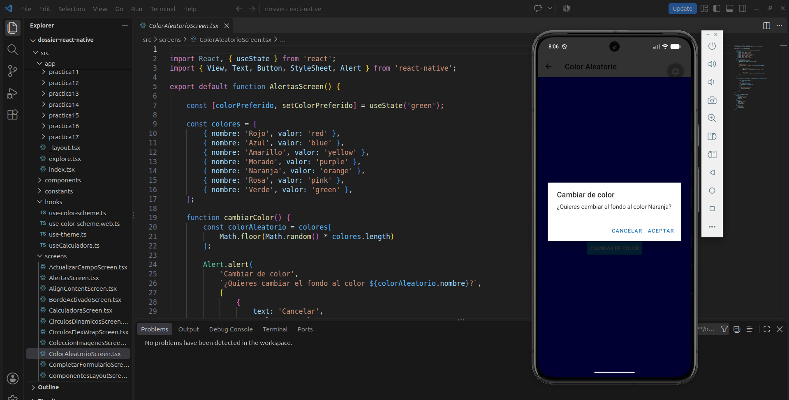

---


### Solicitar texto mediante `Modal` y `TextInput`

`Alert.prompt()` no se utiliza del mismo modo en Android e iOS. Para pedir un valor de texto en ambos sistemas, cread un componente con `Modal`, un `TextInput` y dos controles para cancelar o aceptar.

```tsx
const [visible, setVisible] = useState(false);
const [colorEscrito, setColorEscrito] = useState('lightblue');
// ...
<Modal visible={visible} transparent animationType="fade" onRequestClose={() => setVisible(false)}>
  <View style={{ flex: 1, justifyContent: 'center', padding: 24, backgroundColor: '#0008' }}>
    <View style={{ padding: 20, backgroundColor: 'white', borderRadius: 12 }}>
      <TextInput value={colorEscrito} onChangeText={setColorEscrito} placeholder="Color CSS" />
      <Button title="Cancelar" onPress={() => setVisible(false)} />
      <Button title="Aceptar" onPress={() => { setFondo(colorEscrito); setVisible(false); }} />
    </View>
  </View>
</Modal>
```

> Este ejemplo enseña la estructura del diálogo; antes de utilizar el color escrito, comprobad que sea un valor válido. El estado `fondo` se declara en la pantalla como en la práctica 12.

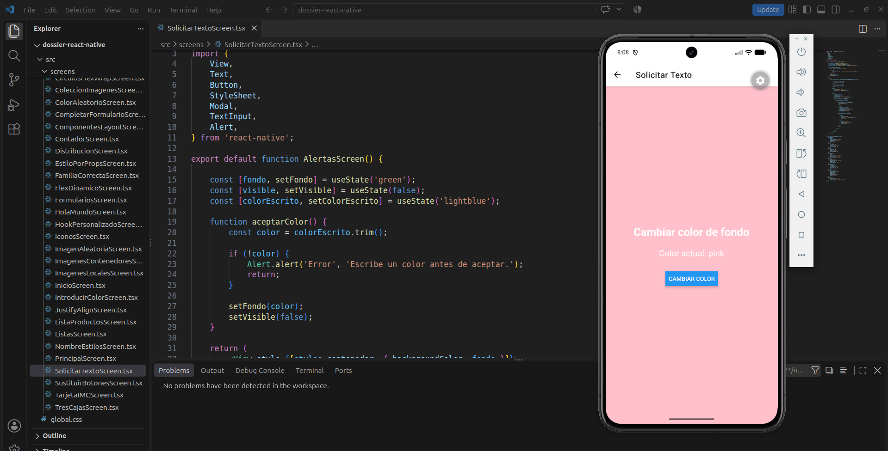

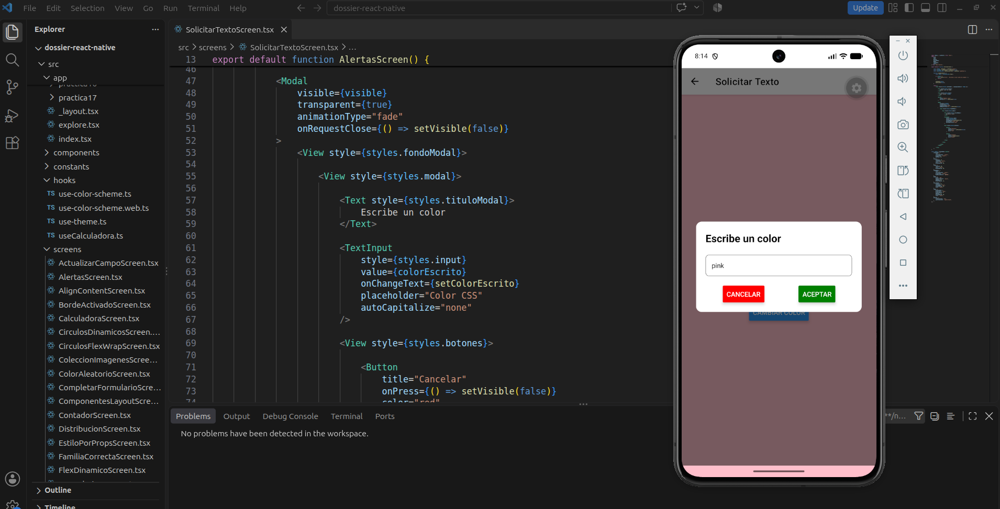

---

### Práctica 13. Introducir el color

Repetid la práctica 12, pero permitiendo escribir el color mediante el diálogo. Al aceptar un valor válido, cambiad el fondo de la pantalla. Si se cancela, no cambiéis nada.

### `Switch`

`Switch` es un control booleano. Se conecta a `value` y `onValueChange` y permite personalizar el color del indicador con `thumbColor`.

```tsx
<Switch value={activo} onValueChange={setActivo} thumbColor={activo ? 'orange' : 'brown'} />
```

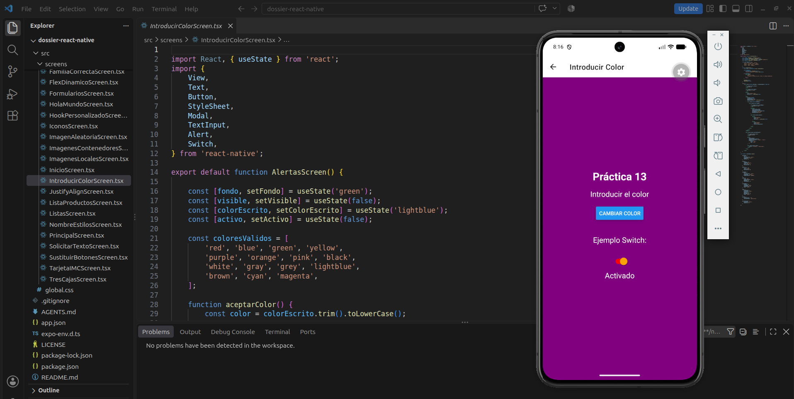

---

### Práctica 14. Borde activado por Switch

Reproducid el control de referencia: indicador marrón cuando está desactivado y naranja cuando está activado. Al activarlo, mostrad un borde rojo alrededor de la pantalla; al desactivarlo, quitad el borde.

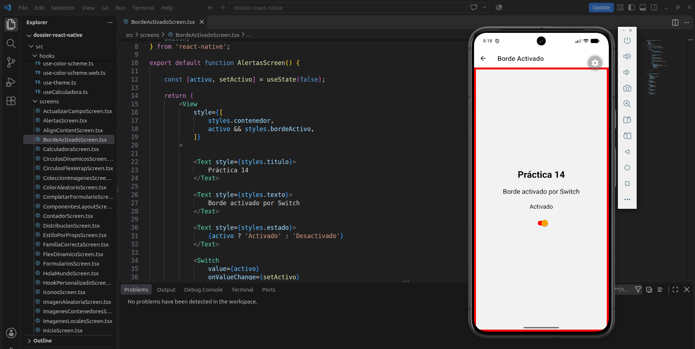

---


### Formularios

En React Native no utilizamos la etiqueta HTML `<form>`. Los componentes `TextInput`, `Switch` y `Button` permiten crear formularios controlados con `useState`.

Para el formulario de persona trabajaremos con los campos `nombre`, `edad`, `casado` y `jubilado`:

```tsx
type DatosPersona = {
  nombre: string;
  edad: string; // TextInput siempre devuelve texto
  casado: boolean;
  jubilado: boolean;
};
const [datos, setDatos] = useState<DatosPersona>({
  nombre: '', edad: '', casado: false, jubilado: false,
});
```

Mantendremos inicialmente la edad como texto y la convertiremos a número al validarla (`Number(datos.edad)`); así evitamos errores al borrar o editar los caracteres del campo.

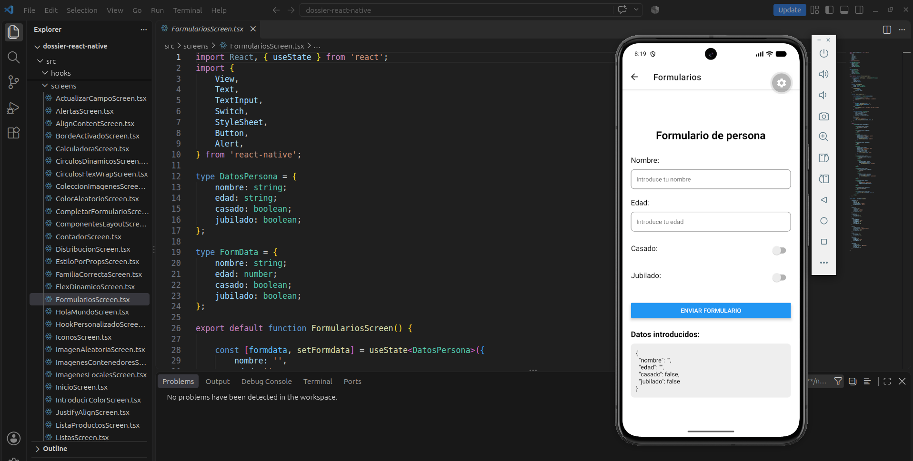

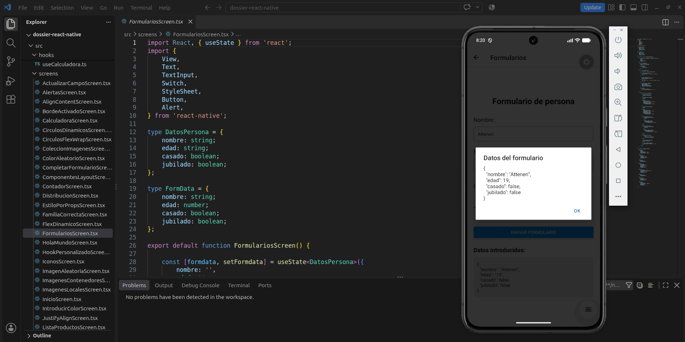

---


### Actualizar un campo del formulario

Podemos utilizar una función reutilizable con un nombre de campo tipado. `keyof DatosPersona` indica que únicamente se admitirán campos existentes en el formulario.

```tsx
function cambiarCampo<K extends keyof DatosPersona>(campo: K, valor: DatosPersona[K]) {
  setDatos(actual => ({ ...actual, [campo]: valor }));
}
// <TextInput value={datos.nombre} onChangeText={v => cambiarCampo('nombre', v)} />
// <Switch value={datos.jubilado} onValueChange={v => cambiarCampo('jubilado', v)} />
```

Al enviar el formulario, comprobad que el nombre no esté vacío y que la edad pueda convertirse en un número válido. Podéis mostrar los datos mediante una alerta o un resumen en pantalla.

---

### Práctica 15. Completar el formulario

Reproducid el ejemplo de persona (nombre, edad y jubilación) e **incorporad el `Switch` del campo `casado`**. Los cuatro campos deben actualizar correctamente el estado y mostrarse en un resumen final.

---


## Listas

React Native incluye `ScrollView`, `FlatList` y `SectionList`. `ScrollView` es útil con pocos elementos porque renderiza todo su contenido; **`FlatList` virtualiza listas largas**, representando preferentemente los elementos próximos a la zona visible. `SectionList` permite agruparlos por secciones.

### `FlatList`

Las propiedades fundamentales son `data`, `renderItem` y `keyExtractor`. Se pueden añadir `ListHeaderComponent`, `ItemSeparatorComponent` y `ListEmptyComponent`.

```tsx
import { FlatList, Text, View } from 'react-native';
const personas = [{ id: '1', nombre: 'Ana' }, { id: '2', nombre: 'Luis' }];
<FlatList
  data={personas}
  keyExtractor={item => item.id}
  renderItem={({ item, index }) => (
    <View style={{ padding: 12, backgroundColor: index % 2 ? '#eee' : '#fff' }}>
      <Text>{item.nombre}</Text>
    </View>
  )}
  ListHeaderComponent={<Text>Lista de personas</Text>}
/>
```

---

### Práctica 16. Lista de productos

Sustituid la lista de personas del ejemplo por una lista de productos. Cada elemento mostrará **nombre, precio y stock**. No añadáis separador entre elementos. Utilizad `index` dentro de `renderItem` para alternar el color de fondo entre posiciones pares e impares. La cabecera debe decir «Lista Productos», estar centrada y tener un tamaño mayor.

---

### Práctica 17. Tarjetas para calcular el IMC

Cread un componente `CardPersona.tsx` con los campos `id`, `nombre`, `altura` y `peso` y el cálculo del índice de masa corporal (IMC = peso en kg / altura en metros al cuadrado). La pantalla contenedora tendrá un botón «+» para añadir tarjetas y cada tarjeta dispondrá de un botón para eliminarla.

**Claves de implementación:** el contenedor mantiene un array de identificadores y crea las tarjetas con claves estables; cada tarjeta puede gestionar sus campos locales, mientras que la eliminación se comunica al componente padre mediante una función recibida por props. Validar las cifras evita dividir entre cero.

---


## Iconos

**Con Expo utilizaremos `@expo/vector-icons`**, que proporciona familias como Ionicons, MaterialIcons o FontAwesome sin modificar manualmente Gradle.

```tsx
import { Ionicons } from '@expo/vector-icons';
<Ionicons name="car-outline" size={40} color="blue" />
```

Consultad los nombres de iconos en https://icons.expo.fyi/ . El nombre debe existir en la familia elegida; los tipos de TypeScript ayudan a localizar errores de escritura.

---


### Elegir la familia correcta de iconos

Cada familia tiene su propio catálogo. Por ejemplo, el icono `car-outline` pertenece a Ionicons y se importa desde `@expo/vector-icons/Ionicons` o como `{ Ionicons }` de `@expo/vector-icons`, según la forma que prefiráis. Las propiedades más habituales son `name`, `size` y `color`.

Las figuras ilustran el aspecto de los iconos, pero la **instalación de fuentes mediante Gradle no se realiza en Expo**. Aseguraos de que los iconos se representan tanto en la práctica como en el emulador.

---