# Dossier de React Native con Expo y Android Studio

Atteneri Bravo Barroso

2ºDAM

## Configuración

**PENDIENTE**: añadir demás comandos

En la terminal, desde la carpeta donde he guardado el proyecto ejecuto:

```bash
npx create-expo-app@latest dossier-react-native --template default
cd dossier-react-native
code .
npx expo start
```

El creador de proyectos instalará Expo, TypeScript y la estructura de rutas de Expo Router. Si os pide confirmar la instalación, aceptad. Con el emulador de Android ya iniciado, pulsad **`a`** en la terminal del servidor de Expo. Si la aplicación no se abre, comprobad el dispositivo con `adb devices` y volved a arrancar el servidor.

> Las plantillas y su estructura evolucionan. Si el proyecto inicial incluye pantallas demostrativas, seguid la guía de limpieza de la plantilla que indique vuestra versión de Expo; conservad `src/app/_layout.tsx` y `src/app/index.tsx` (o `app/` cuando la plantilla no use `src/`). A partir de aquí, todos los ejemplos del dossier consideran `src/app/`.

**Archivos básicos:** `package.json` enumera scripts y dependencias; `app.json` contiene la configuración de Expo; `tsconfig.json` configura TypeScript; `assets/` almacena imágenes; `src/app/` contiene las rutas de navegación.


## Práctica 1. Hola Mundo

En `src/app/index.tsx` cread una pantalla que muestre el mensaje «¡Hola mundo! Soy [vuestro nombre]». Utilizad un `View` y un `Text`; aplicad fondo rosa, `flex: 1`, `justifyContent: 'center'` y `alignItems: 'center'`.

```tsx
import { StyleSheet, Text, View } from 'react-native';

export default function Index() {
  return (
    <View style={styles.pantalla}>
      <Text>¡Hola mundo! Soy ...</Text>
    </View>
  );
}

const styles = StyleSheet.create({
  pantalla: {
    alignItems: 'center',
    backgroundColor: 'lightpink',
    flex: 1,
    justifyContent: 'center',
  },
});
```


## Componentes básicos y layout

### `View`, `Text` y `Button`

`View` es un contenedor visual; equivale a una caja capaz de agrupar otros componentes. `Text` sirve para mostrar texto: no podemos escribir cadenas directamente dentro de un `View` sin envolverlas en `Text`. `Button` presenta un botón nativo con propiedades básicas: `title`, `onPress`, `color` y `accessibilityLabel`.

Estos componentes se importan desde `react-native`, **también al usar Expo**. Un estado creado con `useState` permite actualizar la pantalla cuando cambia su valor:

```tsx
import { useState } from 'react';
import { Button, StyleSheet, Text, View } from 'react-native';

export default function ContadorScreen() {
  const [contador, setContador] = useState(0);
  return (
    <View style={styles.caja}>
      <Text>Contador: {contador}</Text>
      <Button title="Incrementar" onPress={() => setContador(n => n + 1)} />
    </View>
  );
}
const styles = StyleSheet.create({
  caja: { alignItems: 'center', borderWidth: 2, padding: 20 },
});
```

Cuando se pulsa el botón, `setContador` actualiza el estado y React vuelve a representar el componente. No es necesario modificar manualmente el texto de la pantalla.


### Práctica 2. Contador con dos botones

Partiendo del ejemplo anterior, cambiad el color del borde y del fondo, redondead las esquinas con `borderRadius` e incorporad otro botón que decremente el contador. Mostrad el valor en un `Text` y comprobad el resultado en Android Studio.

**Cómo resolverla:** utilizad el mismo estado `contador` y dos funciones `onPress`, una con `setContador(n => n + 1)` y otra con `setContador(n => n - 1)`. Personalizad el contenedor mediante `StyleSheet.create()`; el `Button` nativo no admite la misma personalización que un `View`.

### Separar pantallas, componentes y estilos

Hasta ahora habéis escrito todo en un único archivo. En las siguientes prácticas separaremos los componentes reutilizables (`src/components/`) de las pantallas completas (`src/screens/`). Las pantallas que se abren desde Expo Router necesitan, además, un archivo de ruta dentro de `src/app/`.

`StyleSheet.create()` permite guardar estilos reutilizables y evita llenar el JSX de objetos repetidos:

```tsx
const styles = StyleSheet.create({
  contenedorCircular: {
    backgroundColor: 'rgba(191, 186, 221, 0.54)',
    borderRadius: 100,
    padding: 20,
  },
});
// En el JSX: <View style={styles.contenedorCircular}>...</View>
```

Podéis instalar extensiones de fragmentos de código (*snippets*), pero los atajos concretos dependen de la extensión: no son comandos de Expo.

---


### Práctica 3. `InicioScreen` y estilos separados

Cread `src/screens/InicioScreen.tsx` para colocar el contador de la práctica 2. En `src/app/index.tsx`, importad y mostrad `<InicioScreen />`. Los estilos deberán declararse mediante `StyleSheet.create()`.

**Para conservar las prácticas:** en este momento podéis guardar el «Hola mundo» como `src/screens/HolaMundoScreen.tsx`. Después crearemos un índice de rutas para abrir cada pantalla por separado; no eliminéis el código del primer ejercicio. `src/screens/` contiene la implementación y `src/app/` actuará como enlace a ella cuando configuremos las rutas.

```tsx
// src/app/index.tsx (hasta crear el menú general)
import InicioScreen from '../screens/InicioScreen';
export default function Index() {
  return <InicioScreen />;
}
```

Revisad que ambos archivos funcionen, que no haya errores de importación y que el contador conserve su comportamiento.

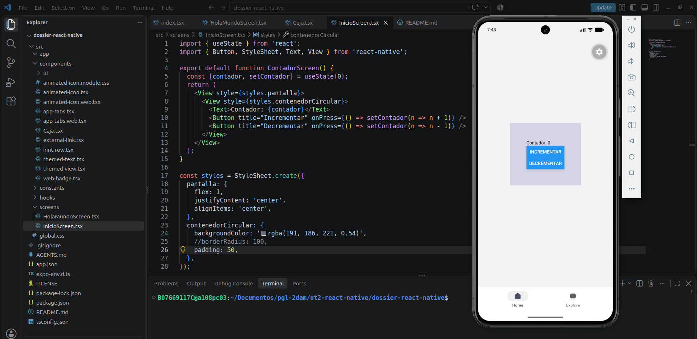

---


### Layout con Flexbox

React Native emplea Flexbox para distribuir componentes. Frente al CSS del navegador, los contenedores se organizan **en columna por defecto** (`flexDirection: 'column'`) y no necesitan `display: 'flex'`. Las unidades numéricas de `width`, `height`, `margin` o `padding` se expresan normalmente como unidades lógicas, sin añadir `px`.

Con `flex: 1` un contenedor ocupa el espacio libre. `flexDirection: 'row'` coloca los hijos en horizontal y `flexDirection: 'column'` los coloca en vertical.

```tsx
// src/components/Caja.tsx
import { StyleSheet, Text, View } from 'react-native';

type Props = { nombre: string; bg?: string };
export default function Caja({ nombre, bg = 'green' }: Props) {
  return (
    <View style={[styles.caja, { backgroundColor: bg }]}>
      <Text>{nombre}</Text>
    </View>
  );
}
const styles = StyleSheet.create({
  caja: { height: 100, width: 100, justifyContent: 'center', alignItems: 'center' },
});
```

La sintaxis `style={[styles.caja, { backgroundColor: bg }]}` combina un estilo base y un valor personalizado, también se puede utilizar la extensión de objetos con `...styles.caja`.


---

### Práctica 4. Tres cajas

Cread una pantalla `PrincipalScreen` con el texto «Contenedor Principal» y un `View` para el escenario. Dentro colocad tres componentes `Caja` de 100 × 100 y enviadles colores diferentes mediante propiedades. El escenario debe tener `flex: 1`.

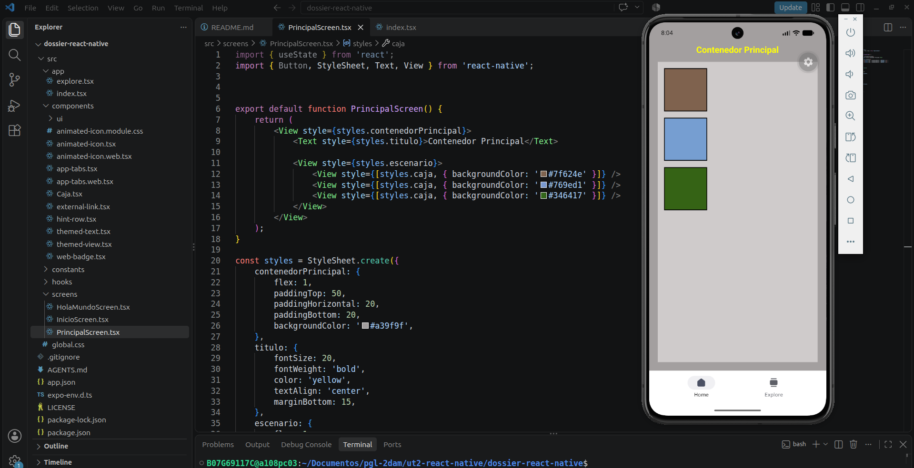

---


### Reparto del espacio con `flex`

`flex` controla cómo se reparte el espacio libre entre elementos hermanos. Dos hijos con `flex: 1` comparten ese espacio; si uno tiene `flex: 2`, recibe el doble de la parte asignada al que tiene `flex: 1`, siempre que las restantes restricciones de tamaño lo permitan.

**Atención:** si una caja tiene `height: 100`, el efecto de `flex` puede verse condicionado por esa altura. Para observar claramente el reparto en la siguiente práctica, podéis usar una variante de la caja sin altura fija.

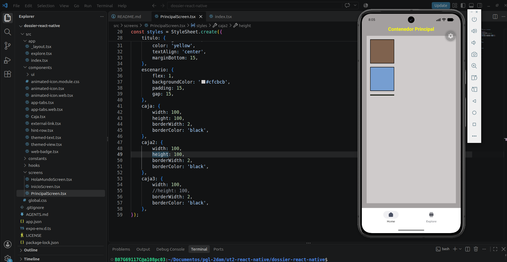

---

### Práctica 5. Modificar `flex` dinámicamente

Añadid a cada caja dos botones: uno incrementará su valor de `flex` y otro lo disminuirá. Mostrad el valor actual de cada caja y comprobad cómo se reorganiza el espacio. Guardad los valores en estados independientes y evitad valores negativos cuando no tengan sentido para vuestro diseño.

```tsx
const [valorFlex, setValorFlex] = useState(0);
// Aplicad { flex: valorFlex } al contenedor de la caja.
// Botones: setValorFlex(n => n + 1) y setValorFlex(n => Math.max(0, n - 1)).
```

El resultado debe seguir siendo consultable cuando paséis a los siguientes ejercicios.


---


### `TouchableOpacity` y `TouchableHighlight`

Los botones nativos permiten poca personalización. React Native incluye componentes que reaccionan al tacto y pueden envolver una interfaz personalizada. `TouchableOpacity` reduce la opacidad al pulsar; `TouchableHighlight` muestra un resaltado. Ambos utilizan `onPress`.

```tsx
import { Alert, Text, TouchableHighlight, TouchableOpacity } from 'react-native';

<TouchableHighlight onPress={() => Alert.alert('Pulsado')} underlayColor="#ddd">
  <Text>Botón destacado</Text>
</TouchableHighlight>

<TouchableOpacity onPress={() => Alert.alert('Pulsado')}>
  <Text>Botón con opacidad</Text>
</TouchableOpacity>
```

En aplicaciones actuales también puede utilizarse `Pressable`, pero para observar las diferencias entre los componentes táctiles trabajaremos aquí con los dos componentes anteriores.


### Práctica 6. Sustituir los botones

Sustituid los botones de la práctica 5: para `flex + 1`, utilizad un `TouchableHighlight` que muestre una alerta y aumente el valor; para `flex - 1`, utilizad `TouchableOpacity` y reducid el valor. Personalizad el aspecto de ambos.

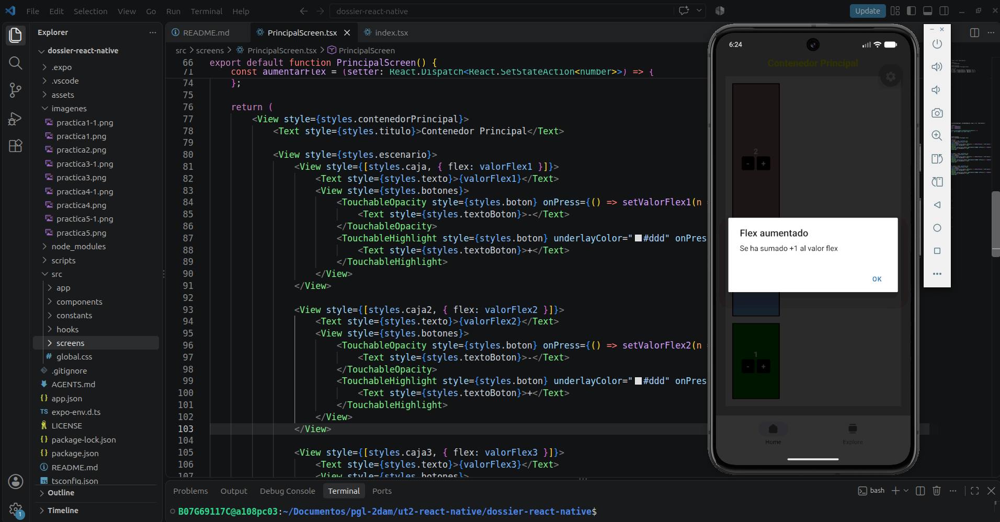

---


### Propiedades de estilo recibidas por un componente

Para personalizar una caja desde la pantalla que la utiliza, declarad una propiedad `style` del tipo `StyleProp<ViewStyle>` y combinad el estilo por defecto con el recibido.

```tsx
import type { StyleProp, ViewStyle } from 'react-native';

type Props = { nombre: string; style?: StyleProp<ViewStyle> };
// En el componente:
// <View style={[styles.porDefecto, style]}><Text>{nombre}</Text></View>
// Al utilizarlo:
// <Caja nombre="Caja B" style={{ borderRadius: 20, borderWidth: 7 }} />
```

El segundo estilo sobrescribe las propiedades repetidas del primero. De esta manera podéis reutilizar el mismo componente sin duplicar su código.


### Práctica 7. Nombre y estilos personalizados

Adaptad la pantalla para que cada caja muestre su nombre (Caja A, B y C) y acepte estilos enviados mediante propiedades. Al menos una caja debe tener esquinas redondeadas y un borde diferente, como se describe en la actividad.

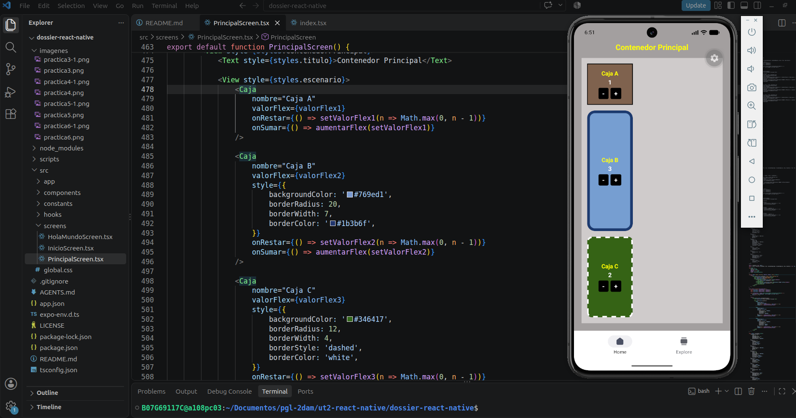

---


### `flexWrap` y `flexDirection`

`flexWrap: 'wrap'` permite que los hijos pasen a la siguiente fila o columna cuando ya no caben. El valor por defecto es `'nowrap'`. `flexDirection` puede valer `'row'`, `'column'`, `'row-reverse'` o `'column-reverse'`.

```tsx
<View style={{ flex: 1, flexDirection: 'row', flexWrap: 'wrap', gap: 8 }}>
  {colores.map((color, index) => (
    <View key={index} style={{ width: 60, height: 60, borderRadius: 30, backgroundColor: color }} />
  ))}
</View>
```

En React es necesario incluir una clave estable (`key`) para cada elemento creado mediante `map`.

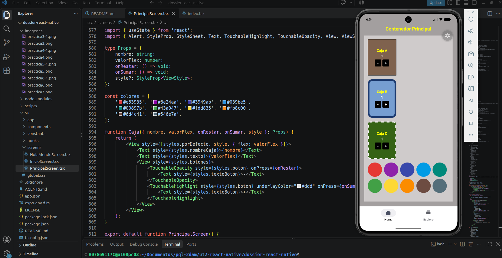


### Práctica 8. Círculos dinámicos

Comenzad con un escenario vacío. Un botón añadirá un círculo de color variable; otros dos alternarán `wrap/nowrap` y `row/column`. Mostrad los controles como botones personalizados (`TouchableOpacity`). Evitad que los valores RGB superen 255; podéis limitar el cálculo con `Math.min(255, valor)`.


---


### `Image`, `TextInput`, `justifyContent` y `alignItems`

`justifyContent` distribuye los elementos a lo largo del eje principal (el que determina `flexDirection`); `alignItems` los alinea sobre el eje transversal. Por ejemplo, con dirección `column`, `justifyContent: 'space-around'` reparte el espacio vertical y `alignItems: 'center'` centra horizontalmente los hijos.

`TextInput` permite introducir texto mediante las propiedades `value`, `placeholder`, `onChangeText` y `style`. En un campo controlado, el valor procede de un estado:

```tsx
const [alineacion, setAlineacion] = useState('center');
<TextInput
  placeholder="center, space-around..."
  value={alineacion}
  onChangeText={setAlineacion}
/>
```

Antes de aplicar lo escrito como valor de `justifyContent`, comprobad que coincide con uno de los valores admitidos. En TypeScript es recomendable definir un tipo unión con esos valores, para evitar errores al asignarlo a estilos.


---


### Contenedores anidados e imágenes

Cada contenedor puede utilizar su propia dirección Flexbox. Así, un `View` con dirección `column` puede contener una fila horizontal de botones dentro de un `View` con `flexDirection: 'row'`.

`Image` representa imágenes locales o remotas. Una imagen por URL se carga indicando `source={{ uri: 'https://...' }}`; una imagen del proyecto utiliza `require` con una ruta estática.

```tsx
import { Image } from 'react-native';
<Image source={{ uri: 'https://reactnative.dev/img/tiny_logo.png' }}
       style={{ width: 80, height: 80 }} />
<Image source={require('../../assets/images/icon.png')}
       style={{ width: 80, height: 80 }} />
```

**Nota:** comprobad la ruta del ejemplo local con los nombres reales de los archivos de vuestro proyecto. Algunas URL de imágenes externas pueden caducar; utilizad imágenes propias o enlaces estables.


---

### Imágenes locales y remotas

Para imágenes remotas empleamos un objeto con `uri`. Para archivos locales agrupados en el proyecto utilizamos `require('ruta-estática')`. No es válido construir dinámicamente la ruta de `require` mediante una variable: el empaquetador debe conocer los archivos durante la compilación.

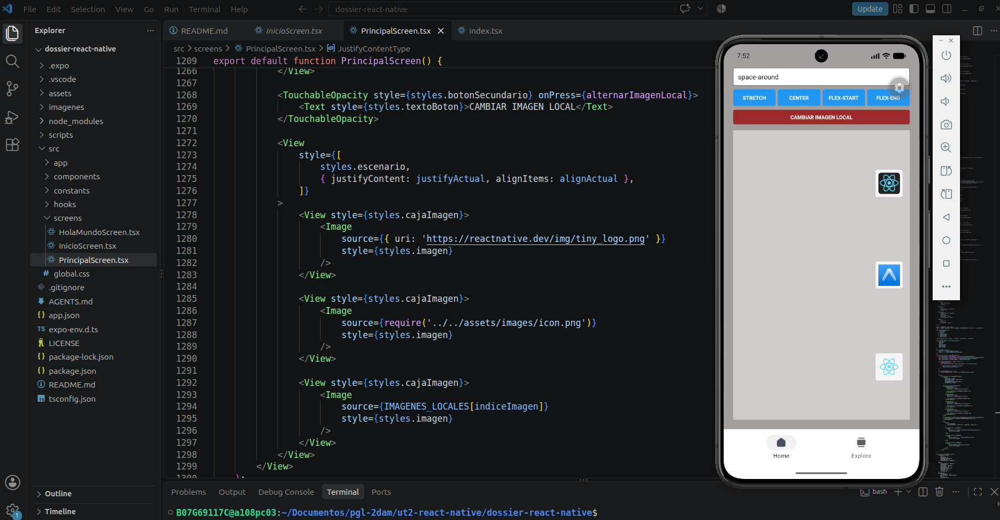

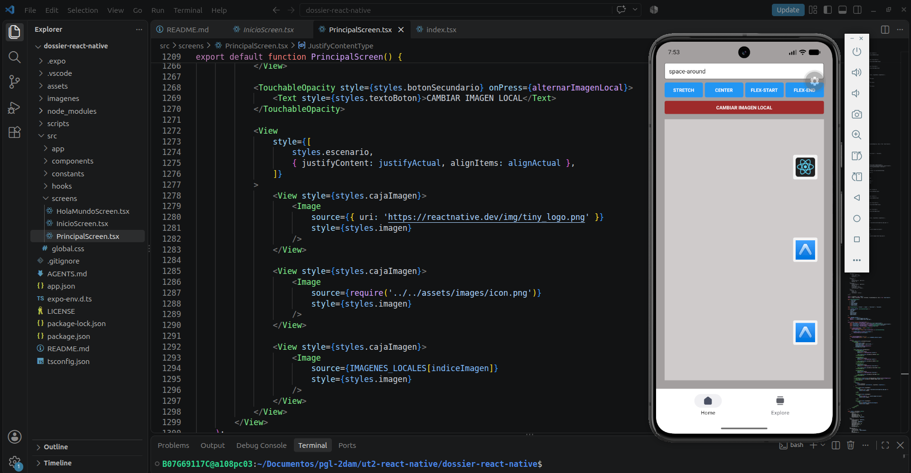


### Práctica 9. Distribución, alineación e imágenes

Cread una pantalla con estos elementos: un campo de texto que permita elegir un valor válido de `justifyContent`, botones para modificar `alignItems` y tres imágenes. **Al menos una de las imágenes deberá cargarse desde los archivos del proyecto mediante `require`**. Las otras pueden ser remotas o locales. Utilizad `flexWrap: 'nowrap'` para observar el efecto de las alineaciones respecto al contenedor.

Indicad en pantalla cuál es la alineación activa, de forma que pueda comprobarse el funcionamiento.

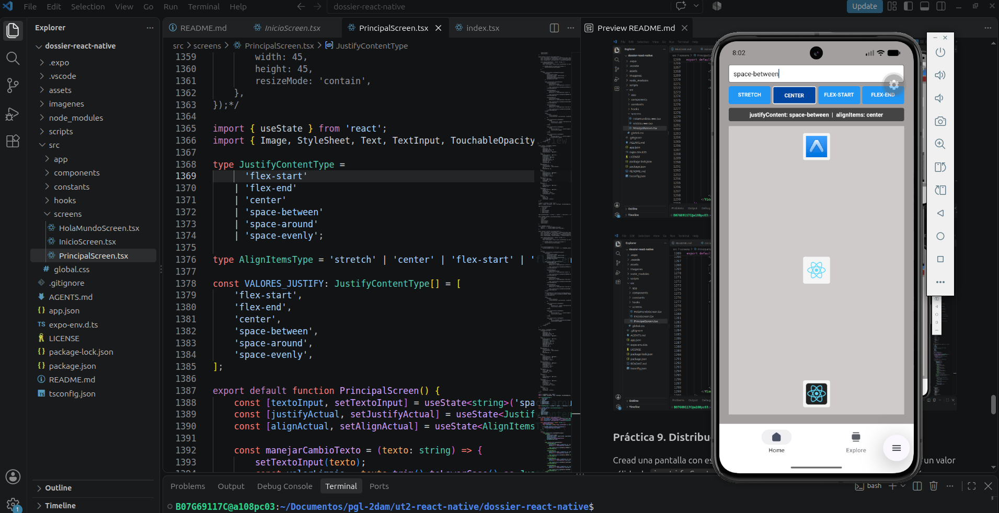


---


### Seleccionar imágenes locales desde una colección

Para elegir una imagen local de forma dinámica, definid previamente una lista cuyos valores contengan llamadas estáticas a `require`:

```tsx
const imagenes = [
  { nombre: 'estrella', source: require('../../assets/estrella.png') },
  { nombre: 'gato', source: require('../../assets/gato.png') },
];
const elegida = imagenes[indice];
// <Image source={elegida.source} style={{width:120,height:120}} />
```

Los archivos `estrella.png` y `gato.png` deben existir antes de ejecutar el ejemplo. La posición seleccionada puede almacenarse en un estado.

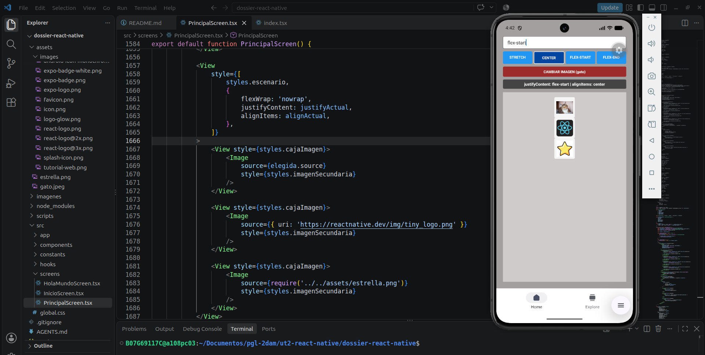

### Práctica 9.1. Imagen aleatoria

Partiendo de una colección de imágenes locales, añadid un botón que elija aleatoriamente una imagen y la muestre. Utilizad `Math.floor(Math.random() * imagenes.length)` y actualizad el índice mediante `useState`.

### Áreas seguras de pantalla

Para evitar que el contenido quede debajo de la barra de estado o de las áreas reservadas de Android, utilizad `SafeAreaView` importado desde **`react-native-safe-area-context`**. En proyectos con Expo Router, podéis aplicarlo a pantallas que lo necesiten o gestionar las zonas seguras desde un contenedor compartido. No utilizaremos la antigua importación de `SafeAreaView` desde `react-native`.

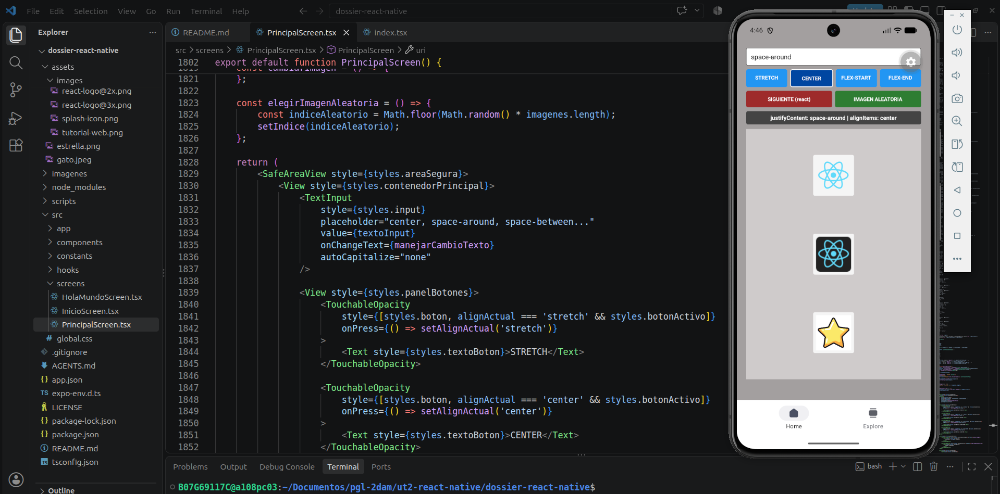

---


### Más propiedades de layout y cálculo

`gap`, `rowGap` y `columnGap` permiten espaciar elementos; `alignContent` distribuye líneas cuando usamos `flexWrap: 'wrap'`; `position` admite `'relative'` y `'absolute'`. El componente `Text` dispone de `adjustsFontSizeToFit` y `numberOfLines` para adaptar un resultado largo al ancho disponible.


### Práctica 10. Calculadora

Reproducid la calculadora de la figura: pantalla de resultado y filas de teclas numéricas y de operaciones. Construid los botones como componentes reutilizables con `TouchableOpacity`. Utilizad Flexbox para las filas y mantened el resultado en un estado. Deben funcionar las operaciones que decidáis implementar según el diseño de referencia; evitad evaluar directamente cadenas arbitrarias con `eval`.

**Organización recomendada:** `CalculadoraScreen.tsx` contendrá la interfaz, y un componente `TeclaCalculadora.tsx` definirá el aspecto y la interacción de cada tecla. Conservad la práctica 10: la práctica siguiente extraerá su lógica a un hook, pero no debe eliminar su resultado.


---


## Estructura de carpetas

Después de las primeras prácticas vamos a organizar de manera más completa **el único proyecto Expo del dossier**. No hace falta crear un proyecto nuevo. Tomad esta estructura como referencia y añadid carpetas cuando realmente se utilicen:

```text
src/
├── app/
│   ├── _layout.tsx
│   ├── index.tsx                # Índice general de prácticas
│   ├── practica01.tsx
│   ├── practica02.tsx
│   ├── ...
│   └── practica40.tsx
├── screens/                    # Pantallas con la implementación
├── components/                 # Componentes reutilizables
├── hooks/                      # Hooks personalizados
├── context/                    # Estados compartidos
├── api/                        # Peticiones HTTP
├── db/                         # SQLite y consultas
├── navigation/                 # Ayudas de navegación, si se necesitan
└── theme/                      # Estilos, colores y constantes
assets/                          # Imágenes y recursos
```

Los archivos dentro de `src/app/` son **rutas de Expo Router**. Podéis exportar desde ellos una pantalla definida en `src/screens/`, por ejemplo: `export { default } from '../screens/InicioScreen';`. Para ejercicios con varias pantallas (Stack, Drawer, Tabs) crearemos una **carpeta de rutas exclusiva para ese ejercicio**, con su propio `_layout.tsx`.

Para que no desaparezcan las prácticas 1–10, cread ahora las rutas necesarias y transformad `src/app/index.tsx` en un **índice de ejercicios**. El ejemplo siguiente puede ampliarse conforme avancéis:

```tsx
import { Link } from 'expo-router';
import { ScrollView, Text } from 'react-native';
export default function Index() {
  return (
    <ScrollView contentContainerStyle={{ padding: 20, gap: 16 }}>
      <Text>Prácticas de React Native con Expo</Text>
      <Link href="/practica01">Práctica 1</Link>
      <Link href="/practica02">Práctica 2</Link>
    </ScrollView>
  );
}
```

Cada ruta deberá apuntar a un archivo real: por ejemplo, `src/app/practica01.tsx` exporta `HolaMundoScreen`. Ampliad el índice según vayáis creando prácticas. **No situéis componentes auxiliares sueltos dentro de `src/app/`**, porque Expo Router puede interpretarlos como rutas.