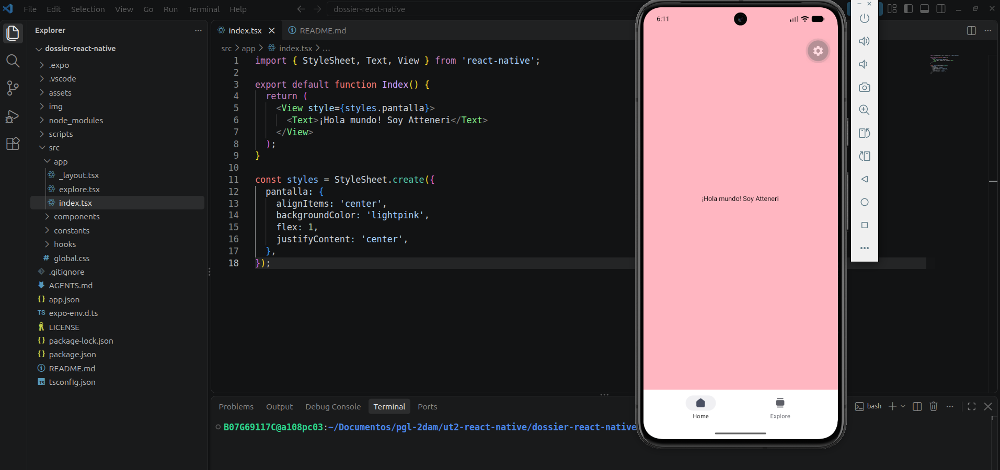
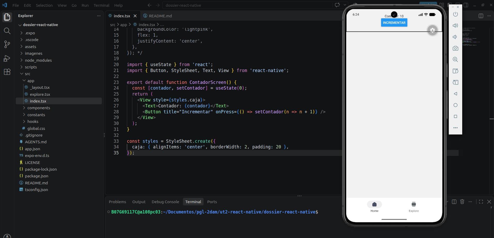
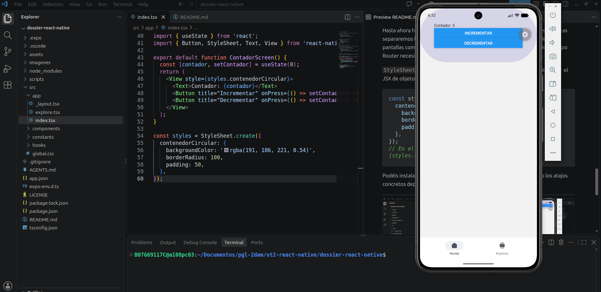

# Dossier de React Native con Expo y Android Studio

Atteneri Bravo Barroso

2ºDAM

## Configuración

En la terminal, desde la carpeta donde he guardado el proyecto ejecuto:

```bash
npx create-expo-app@latest dossier-react-native --template default
cd dossier-react-native
code .
npx expo start
```

El creador de proyectos instalará Expo, TypeScript y la estructura de rutas de Expo Router. Si os pide confirmar la instalación, aceptad. Con el emulador de Android ya iniciado, pulsad **`a`** en la terminal del servidor de Expo. Si la aplicación no se abre, comprobad el dispositivo con `adb devices` y volved a arrancar el servidor.

> Las plantillas y su estructura evolucionan. Si el proyecto inicial incluye pantallas demostrativas, seguid la guía de limpieza de la plantilla que indique vuestra versión de Expo; conservad `src/app/_layout.tsx` y `src/app/index.tsx` (o `app/` cuando la plantilla no use `src/`). A partir de aquí, todos los ejemplos del dossier consideran `src/app/`.

**Archivos básicos:** `package.json` enumera scripts y dependencias; `app.json` contiene la configuración de Expo; `tsconfig.json` configura TypeScript; `assets/` almacena imágenes; `src/app/` contiene las rutas de navegación.


## Práctica 1. Hola Mundo

En `src/app/index.tsx` cread una pantalla que muestre el mensaje «¡Hola mundo! Soy [vuestro nombre]». Utilizad un `View` y un `Text`; aplicad fondo rosa, `flex: 1`, `justifyContent: 'center'` y `alignItems: 'center'`.

```tsx
import { StyleSheet, Text, View } from 'react-native';

export default function Index() {
  return (
    <View style={styles.pantalla}>
      <Text>¡Hola mundo! Soy ...</Text>
    </View>
  );
}

const styles = StyleSheet.create({
  pantalla: {
    alignItems: 'center',
    backgroundColor: 'lightpink',
    flex: 1,
    justifyContent: 'center',
  },
});
```



## Componentes básicos y layout

### `View`, `Text` y `Button`

`View` es un contenedor visual; equivale a una caja capaz de agrupar otros componentes. `Text` sirve para mostrar texto: no podemos escribir cadenas directamente dentro de un `View` sin envolverlas en `Text`. `Button` presenta un botón nativo con propiedades básicas: `title`, `onPress`, `color` y `accessibilityLabel`.

Estos componentes se importan desde `react-native`, **también al usar Expo**. Un estado creado con `useState` permite actualizar la pantalla cuando cambia su valor:

```tsx
import { useState } from 'react';
import { Button, StyleSheet, Text, View } from 'react-native';

export default function ContadorScreen() {
  const [contador, setContador] = useState(0);
  return (
    <View style={styles.caja}>
      <Text>Contador: {contador}</Text>
      <Button title="Incrementar" onPress={() => setContador(n => n + 1)} />
    </View>
  );
}
const styles = StyleSheet.create({
  caja: { alignItems: 'center', borderWidth: 2, padding: 20 },
});
```

Cuando se pulsa el botón, `setContador` actualiza el estado y React vuelve a representar el componente. No es necesario modificar manualmente el texto de la pantalla.



### Práctica 2. Contador con dos botones

Partiendo del ejemplo anterior, cambiad el color del borde y del fondo, redondead las esquinas con `borderRadius` e incorporad otro botón que decremente el contador. Mostrad el valor en un `Text` y comprobad el resultado en Android Studio.

**Cómo resolverla:** utilizad el mismo estado `contador` y dos funciones `onPress`, una con `setContador(n => n + 1)` y otra con `setContador(n => n - 1)`. Personalizad el contenedor mediante `StyleSheet.create()`; el `Button` nativo no admite la misma personalización que un `View`.

### Separar pantallas, componentes y estilos

Hasta ahora habéis escrito todo en un único archivo. En las siguientes prácticas separaremos los componentes reutilizables (`src/components/`) de las pantallas completas (`src/screens/`). Las pantallas que se abren desde Expo Router necesitan, además, un archivo de ruta dentro de `src/app/`.

`StyleSheet.create()` permite guardar estilos reutilizables y evita llenar el JSX de objetos repetidos:

```tsx
const styles = StyleSheet.create({
  contenedorCircular: {
    backgroundColor: 'rgba(191, 186, 221, 0.54)',
    borderRadius: 100,
    padding: 20,
  },
});
// En el JSX: <View style={styles.contenedorCircular}>...</View>
```

Podéis instalar extensiones de fragmentos de código (*snippets*), pero los atajos concretos dependen de la extensión: no son comandos de Expo.

---


