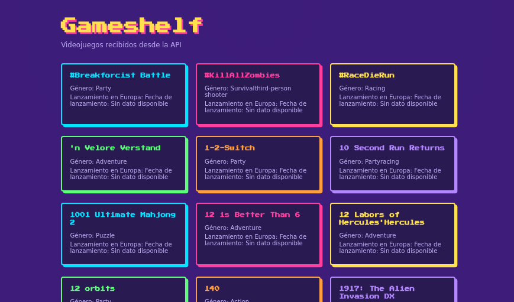
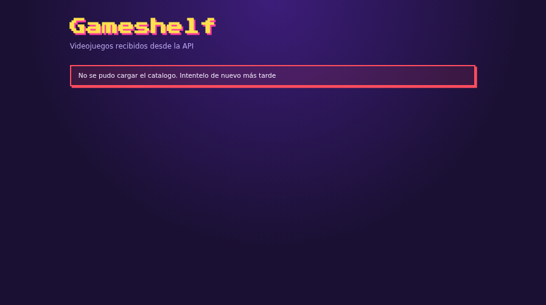
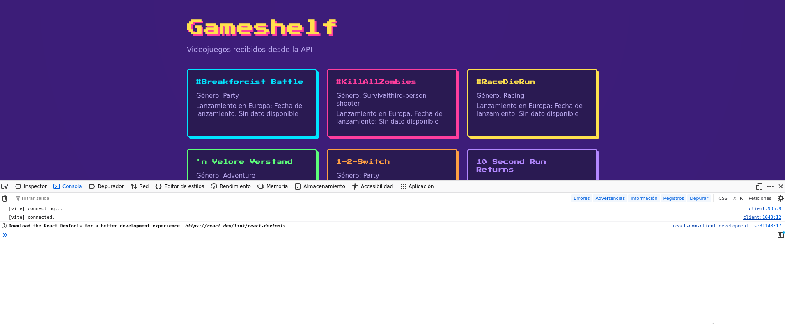

## Qué es Axios y para qué se utiliza

Axios es una popular librería de JavaScript basada en promesas que actúa como un cliente HTTP. En términos sencillos, es el "mensajero" digital que utiliza tu aplicación frontend (como React) para comunicarse con servidores externos y APIs a través de internet.

## Qué es una dependencia, qué función tiene npm y qué contiene `node_modules`

- Una dependencia es un paquete de código externo o librería desarrollado por terceros (en este caso, Axios) que tu aplicación requiere obligatoriamente para funcionar. En lugar de escribir desde cero el código para conectarte a internet, "dependes" de una librería ya testeada y optimizada.

- `npm` es el Gestor de Paquetes de Node. Funciona como una herramienta de línea de comandos y, a la vez, como un enorme mercado en la nube repleto de herramientas compartidas por programadores de todo el mundo. Su función es automatizar la descarga, actualización, desinstalación y configuración de todas las dependencias que listes en tu archivo package.json.

- `node_modules` contiene los archivos físicos con el código fuente de Axios y de cualquier otra librería que use tu proyecto. Además de la carpeta de Axios, verás decenas de carpetas adicionales: son las "dependencias de tus dependencias" (el código secundario que Axios u otras librerías necesitan internamente para hacer su trabajo).

## Qué cambió en `package.json`, qué hace Axios y qué descubrimos sobre esos archivos y herramientas

Al instalar la librería, se añadió automáticamente un nuevo registro dentro del objeto `"dependencies"`. Visualmente, tu archivo ahora muestra una línea similar a esta:

```
"dependencies": {
    "axios": "^1.20.0",
    "react": "^19.2.8",
    "react-dom": "^19.2.8"
  },
```

Su trabajo principal es ir a buscar los datos de los videojuegos, convertirlos automáticamente a objetos de JavaScript (sin que tengas que transformarlos manualmente a JSON) y entregártelos listos para guardarlos en el estado de React (`useState`).

Al instalar Axios con el comando npm install axios, pusiste en marcha el motor de dependencias de Node.js y pudiste comprobar cómo cooperan estos tres elementos:

- `npm` (Node Package Manager): Descubriste que es el administrador y el instalador automático del proyecto. Se encarga de buscar la librería Axios en internet, descargarla de forma segura y acomodarla en tu entorno de desarrollo.

- `package.json`: Es el inventario o "manual de instrucciones" de tu aplicación. Descubriste que tras la instalación, se modificó solo para añadir a "axios" en la sección de "dependencies". Esto le dice a cualquier otro programador (o a ti mismo en el futuro) qué librerías externas se necesitan exactamente para que el proyecto encienda.

- `node_modules/`: Es el almacén físico del proyecto. Descubriste que allí dentro se descargó el código real de Axios junto con cientos de otras carpetas de soporte. Al ser un espacio automatizado por npm y extremadamente pesado, aprendiste la regla de oro: nunca se debe editar a mano ni subir a plataformas como GitHub, ya que se puede regenerar limpiamente en cualquier ordenador ejecutando el comando `npm install`.

## Preguntas


**1. ¿Cómo se importa Axios en un archivo TypeScript?**

Para utilizar Axios en cualquier componente de React con TypeScript, se debe importar en la parte superior del archivo con la siguiente línea de código:

`import axios from 'axios';`

**2. ¿Cómo se solicita información con una petición GET?**

Se solicita utilizando el método `.get()` de Axios, pasándole como argumento la dirección URL (o endpoint) del servidor al que queremos consultar. En un entorno moderno se escribe así:

`const respuesta = await axios.get("https://sampleapis.com");
`

**3. ¿Qué devuelve Axios y dónde están los datos de la respuesta?**

Axios devuelve un objeto contenedor de respuesta `HTTP` (que incluye información como el código de `estado` status y las cabeceras `headers`).

Los datos reales y útiles devueltos por el servidor (en este caso, la lista de videojuegos) se encuentran estrictamente dentro de la propiedad `.data` de ese objeto (por ejemplo: `respuesta.data`).

**4. ¿Qué significa que una operación sea asíncrona? ¿Qué son una promesa, async y await?**

- **Operación asíncrona**: Es una tarea que tarda un tiempo en completarse (como traer datos por internet). En lugar de congelar la aplicación mientras espera, el programa continúa ejecutando otras líneas de código en segundo plano.

- **Promesa**: Es un objeto especial en JavaScript que representa el "resultado futuro" de esa operación asíncrona. Promete que en algún momento terminará con éxito (dando los datos) o con fallo (dando un error).

- `async`: Es una palabra clave que se coloca antes de una función para avisarle a JavaScript que dentro de ella habrá tareas asíncronas que tardarán en responder.

- `await`: Es una palabra clave que solo se puede usar dentro de funciones `async`. Le dice al código: "Espera pacientemente en esta línea hasta que la promesa se resuelva (lleguen los datos de Axios) antes de continuar con la siguiente línea".

**5. ¿Cómo puede React guardar los datos recibidos y actualizar la página?**

React utiliza el hook `useState`. Las variables normales de JavaScript no tienen la capacidad de redibujar la pantalla. `useState` te proporciona una variable para almacenar los videojuegos y una función modificadora (ej. `setGames`). Cuando llamas a esa función con los datos nuevos de la API, React detecta el cambio automáticamente y vuelve a renderizar (actualizar) la página en el navegador.

**6. ¿Cómo se inicia una operación externa, como una petición, cuando se muestra un componente?**

Se utiliza el hook `useEffect` configurado con un array de dependencias vacío `[]` al final. Esto le indica a React que debe ejecutar la petición de Axios una sola vez, justamente en el instante en el que el componente se monta y aparece por primera vez en la pantalla del usuario.

**7. ¿Cómo se recorre una lista para mostrar un elemento por videojuego?**

Se utiliza el método interactivo `.map()` de JavaScript dentro del código JSX. Este método recorre el array de datos elemento por elemento y transforma cada videojuego en un componente visual (como un `<li>` o tu `<GameCard />`). Es obligatorio asignarle un atributo único `key` (como `key={game.id}`) para que React rastree los elementos eficientemente.

```
{games.map((game) => (
  <GameCard key={game.id} title={game.name} genre={game.genre.join(", ")} />
))}
```

**8. Como el proyecto usa TypeScript, ¿qué tipo describe los juegos? Basa sus propiedades en el JSON que has observado.**

Basándonos en la estructura real que devuelve el JSON de la API de SampleAPIs para Nintendo Switch, el tipo (`type`) en TypeScript se define modelando las propiedades exactas y sus tipos de datos correspondientes:

```
type Game = {
  id: number;        // Un número identificador único
  name: string;      // Una cadena de texto con el título del juego
  genre: string[];   // Un array/lista de cadenas de texto con los géneros del juego
};
```

**9. ¿Cómo puedes limitar la cantidad de juegos que muestras?**

Se utiliza el método de arrays `.slice()` justo antes de aplicar el `.map()`. Este método extrae una sección del array sin modificar el original. Por ejemplo, si quieres limitar la lista para mostrar únicamente los primeros 5 videojuegos de la API, escribirías en tu renderizado:

```
games.slice(0, 5).map((game) => ( ... ))
```
---

## Funcionamiento

### `main.tsx`

Este archivo es el **punto de entrada** de la aplicación. Su función principal es tomar el componente principal (`App`), conectarlo con el archivo HTML real del navegador y arrancar React.

---

#### 1. Importaciones (`Imports`)
* **`import { StrictMode } from 'react'`**: Importa una herramienta de React que ayuda a detectar problemas potenciales en el código durante la etapa de desarrollo (hace comprobaciones y advertencias adicionales).

* **`import { createRoot } from 'react-dom/client'`**: Importa el método oficial de React 18+ para inicializar y renderizar una aplicación dentro del DOM (la estructura de la página web).

* **`import App from './App.tsx'`**: Importa el componente raíz de la aplicación (el archivo con el catálogo de videojuegos que revisamos antes).

---

#### 2. Inicialización y Renderizado (`createRoot`)
* **`document.getElementById('root')`**: Busca en el archivo `index.html` de tu proyecto un contenedor físico (normalmente un `<div id="root"></div>`) donde se va a dibujar toda la aplicación.
* **El signo de exclamación (`!`)**: Es un operador de TypeScript (Non-null assertion operator). Le asegura a TypeScript que ese elemento con ID "root" realmente existe en el HTML y que no va a ser `null`.

* **`createRoot(...)`**: Crea la raíz de React asociada a ese contenedor del HTML.

* **`.render(...)`**: Dibuja y monta los componentes en la pantalla.

---

#### 3. Componentes Renderizados
* **`<StrictMode>`**: Envuelve a la aplicación. No dibuja nada visual en la pantalla, pero activa advertencias y revisiones estrictas en la consola para ayudarte a escribir mejor código.

* **`<App />`**: Es el componente principal que contiene toda la lógica del catálogo de videojuegos. Al colocarse aquí, se convierte en el nodo raíz del que colgará el resto de la web.

---

### `types/Game.ts`

Este archivo define la estructura de datos estricta (el "contrato") que debe cumplir cualquier objeto que represente a un videojuego dentro de la aplicación. Ayuda a que el editor de código ofrezca autocompletado y detecte errores antes de ejecutar la app.

---

#### 1. Exportación del Tipo (`export type Game`)
* **`export`**: Permite que este tipo de dato pueda ser importado y reutilizado en otros archivos del proyecto (como en `App.tsx` mediante `import type { Game } ...`).

* **`type Game = { ... }`**: Declara un nuevo tipo personalizado en TypeScript llamado `Game`.

---

#### 2. Propiedades Obligatorias
Son los datos que el videojuego **sí o sí** debe contener. Si falta alguno de estos, TypeScript marcará un error:
* **`id: number;`**: El identificador único del videojuego en la base de datos (un número).

* **`name: string;`**: El título o nombre del videojuego (una cadena de texto).

---

#### 3. Propiedades Opcionales (Operador `?`)
El símbolo de interrogación `?` indica que estas propiedades son **opcionales**. El videojuego puede o no traer esta información desde la API y la aplicación no se romperá:

* **`genre?: string;`**: El género del videojuego (por ejemplo: "Platformer", "RPG"). Es opcional porque algunas APIs de prueba pueden no tener este dato en todos los registros.
* **`releaseDate?: { ... };`**: Un objeto anidado opcional que guarda las fechas de lanzamiento divididas por regiones geográficas.

  * **`Europe?: string;`**: Fecha de lanzamiento en Europa (texto).

  * **`Japan?: string;`**: Fecha de lanzamiento en Japón (texto).

  * **`NorthAmerica?: string;`**: Fecha de lanzamiento en Norteamérica (texto).

  * **`Australia?: string;`**: Fecha de lanzamiento en Australia (texto).

---

### `App.tsx`

Este componente principal (`App`) se encarga de conectar con una API externa, descargar un catálogo de videojuegos de Nintendo Switch y renderizarlos en la pantalla controlando los estados de carga y error.

---

#### 1. Importaciones (`Imports`)
* **`import { useEffect, useState } from "react";`**: Trae los Hooks básicos de React. `useState` maneja la memoria local del componente y `useEffect` controla los efectos secundarios (como llamadas a APIs).
* **`import axios from "axios";`**: Importa la librería cliente HTTP para realizar la petición `GET` al servidor de datos.

* **`import GameCard from "./components/GameCard";`**: Importa el subcomponente encargado de la representación visual individual de cada juego.

* **`import "./App.css";`**: Carga la hoja de estilos CSS correspondiente para aplicar el diseño visual.

* **`import type { Game } from "./types/Game";`**: Importa la interfaz o tipo de TypeScript para asegurar el autocompletado y tipado estricto del objeto de tipo videojuego.

---

#### 2. Configuración
* **`const API_URL = "https://sampleapis.com";`**: Define la dirección URL estática de la API pública que aloja el catálogo de videojuegos.

---

#### 3. Estados del Componente
* **`games`**: Almacena el listado de juegos como un array de objetos tipo `Game`. Empieza vacío (`[]`).

* **`loading`**: Interruptor booleano (`true`/`false`) para saber si la aplicación está descargando datos o si ya terminó.

* **`error`**: Almacena un mensaje en formato string si la petición falla, o se mantiene en `null` si todo va bien.

---

#### 4. Ciclo de Vida y Petición Asíncrona (`useEffect`)
El bloque `useEffect` se ejecuta una única vez al renderizarse el componente por primera vez debido a su array de dependencias vacío `[]`.
* **`try`**: Lanza la petición HTTP. Si es exitosa, guarda los datos recibidos mediante `setGames`.

* **`catch`**: Si el servidor falla o no hay internet, captura el error en la consola y setea un mensaje amigable para el usuario mediante `setError`.

* **`finally`**: Sin importar si la petición fue exitosa o fallida, cambia `loading` a `false` para ocultar la pantalla de carga.

* **`loadGames()`**: Invoca la función asíncrona inmediatamente tras ser definida.

---

#### 5. Renderizado Condicional de la Interfaz
El componente retorna una estructura HTML semántica utilizando evaluaciones lógicas (`&&`) para mostrar la interfaz correcta según el estado actual:
* **Cargando**: Muestra `<p role="status">` únicamente si `loading` es verdadero.

* **Error**: Muestra `<p role="alert">` con el mensaje informativo si `error` contiene texto.
* **Lista Vacía**: Si terminó de cargar, no hay error y el array de juegos tiene longitud cero, avisa que la API no devolvió datos.

* **Catálogo**: Si terminó de cargar, no hay errores y existen juegos, recorre el array mediante `.map()` y genera un componente `<GameCard>` por cada videojuego, asignándole obligatoriamente su propiedad única `key={game.id}`.

---

#### 6. Exportación
* **`export default App;`**: Hace que este componente esté disponible para ser importado e inicializado desde el archivo raíz de la aplicación (`main.tsx` o `index.js`).

---

### `componentes/GameCard.tsx`

Este componente es de tipo **presentacional** o "tonto" (dumb component). Su única responsabilidad es recibir los datos de un videojuego específico a través de sus propiedades (`props`) y maquetar su interfaz visual de forma segura.

---

#### 1. Importaciones y Tipado de `Props`
* **`import type { Game } from "../types/Game.ts";`**: Trae la estructura de datos que definimos en el archivo de tipos para asegurarse de que el objeto del juego contenga las propiedades correctas.

* **`type GameCardProps = { game: Game; };`**: Define la estructura de las propiedades (`props`) que este componente necesita obligatoriamente para funcionar. En este caso, exige recibir un objeto llamado `game` que cumpla con el tipo `Game`.

---

#### 2. Declaración del Componente y Desestructuración
* **`export default function GameCard({ game }: GameCardProps)`**: Declara y exporta el componente por defecto. Utiliza la **desestructuración** directamente en los argumentos (`{ game }`) para extraer el objeto del juego limpiamente sin tener que escribir `props.game` en cada línea.

---

#### 3. Renderizado Seguro (Estructura HTML)
El componente retorna una etiqueta semántica `<article className="card">` para agrupar visualmente la información de la tarjeta utilizando dos estrategias clave de TypeScript y JavaScript moderno:

* **`{game.name}`**: Muestra el nombre del juego directamente dentro de un encabezado `<h2>` (ya que es un dato obligatorio).

* **Operador de Coalescencia Nula (`??`) en el Género**: 
  * `game.genre ?? "Sin género disponible"`
  * Como el género es opcional en nuestro tipo `Game`, si la API devuelve este valor vacío (`null` o `undefined`), el operador `??` actúa como un salvavidas y pinta el texto por defecto *"Sin género disponible"* en lugar de dejar la pantalla en blanco.
* **Encadenamiento Opcional (`?.`) y Coalescencia Nula (`??`) en la Fecha**:
  * `game.releaseDate?.Europe ?? "Sin dato disponible"`
  * Aquí se combinan dos niveles de seguridad. El punto e interrogación (`?.`) evita que la aplicación se rompa si el objeto completo `releaseDate` no existe en la API. Si todo ese camino resulta estar vacío, el operador `??` vuelve a saltar para pintar *"Sin dato disponible"*.

---

### `App.css`

Este archivo se encarga de dar toda la **identidad visual y el diseño estructurado** a la aplicación. En lugar de un diseño web genérico, mi proyecto aplica una **estética "retro / arcade" (estilo píxel de videojuegos)** muy marcada mediante las siguientes acciones principales:

* **Establece una paleta de colores neón y temas oscuros:** Define variables de diseño para mantener la coherencia visual con fondos morados muy profundos, textos claros y colores muy llamativos (cian, rosa, amarillo, verde, naranja) inspirados en videojuegos clásicos.

* **Configura fuentes tipográficas retro:** Importa y aplica la fuente de texto pixelada `'Press Start 2P'` tanto en el título principal de la aplicación como en los nombres de cada videojuego para forzar el aspecto arcade.

* **Crea una estructura de catálogo automática y adaptable (Responsive):** Organiza los videojuegos utilizando una cuadrícula inteligente (`CSS Grid`). Esto hace que las tarjetas se acomoden solas en filas y columnas dependiendo del tamaño de la pantalla del dispositivo (móvil, tablet o monitor) sin romperse.

* **Aplica un patrón dinámico de colores a las tarjetas:** Utiliza selectores avanzados para que las tarjetas de los videojuegos cambien de color de forma alterna y cíclica. Así, la interfaz rompe la monotonía mostrando bordes y sombras en rosa, amarillo, verde o cian a medida que aparecen en la lista.

* **Añade interactividad visual (Efecto Hover):** Configura animaciones suaves para que cuando el usuario pase el ratón por encima de cualquier videojuego, la tarjeta parezca "elevarse" en 3D aumentando la profundidad de su sombra rígida.

* **Da formato a los estados de la aplicación:** Decora de manera llamativa el indicador de carga y genera una caja de alerta de estilo "pixel-art" con bordes gruesos y sombras duras en color rojo si la conexión con la API llega a fallar.

---

## Comprobaciones

- La aplicación se inicia.
- Aparecen juegos después de recibir la respuesta.
- Los nombres y géneros vienen de la API.

<br>



- Se ve algún indicador mientras carga.

<br>


- Hay un mensaje claro si falla la petición.

<br>



- La consola del navegador no muestra errores.

<br>

